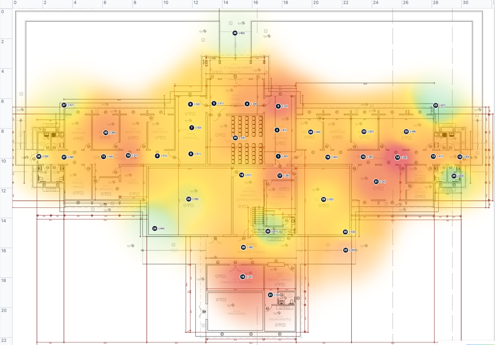

# WiFi Viewer

Aplicativo desktop (Electron) para uso individual e acadêmico que transforma leituras de varredura Wi-Fi — importadas de arquivos de scan ou capturadas ao vivo — em um **heatmap de cobertura** sobreposto à planta de um prédio. Você marca manualmente, sobre a imagem da planta, o ponto onde cada leitura foi coletada; o app interpola essas leituras para gerar mapas de calor por rede, permitindo enxergar zonas de sinal fraco, sobreposição de canais e redes concorrentes.

Funciona de forma parecida com ferramentas de site survey como NetSpot ou Ekahau, porém com escopo simplificado para uso individual/acadêmico — sem conta, sem nuvem, sem custo.



> Exemplo real de uso está documentado em [docs/03-case-study.md](docs/03-case-study.md).

## O que o app faz

- **Captura ao vivo** da varredura Wi-Fi nativa do sistema operacional (Windows, Linux e macOS), sem depender de processos externos.
- **Importação de arquivo de scan** (CSV no formato de referência) associado a um ponto físico da planta.
- **Heatmap de força de sinal (dBm)** por rede (SSID) ou por rádio/banda individual (BSSID), sobreposto à imagem da planta.
- **Visão de canais/interferência**, evidenciando sobreposição de canais e conflitos entre redes nas bandas 2.4GHz e 5GHz.
- **Múltiplas plantas** (por prédio ou por andar) dentro de um mesmo levantamento, com navegação por sidebar.
- **Calibração de escala** opcional (dois cliques + distância real) para heatmap espacialmente preciso, com réguas em metros.

O que o app **não** faz, por decisão deliberada: administração de rede (configurar/reiniciar APs), posicionamento indoor automático (GPS/BLE/triangulação), uso multiusuário/corporativo, ou monitoramento contínuo com alertas. Detalhes em [Fora de Escopo](docs/01-prd.md#11-fora-de-escopo).

## Stack

Electron (processo `main/` em Node.js + TypeScript) com um renderer React + TypeScript + Vite rodando no Chromium embutido. Sem backend remoto — tudo é persistido localmente via IndexedDB (`idb`). O heatmap é calculado por interpolação IDW (Inverse Distance Weighting) em um Web Worker e desenhado em `<canvas>`.

Descrição completa dos componentes, fluxo de dados e decisões de arquitetura em [docs/02-arch.md](docs/02-arch.md).

## Como rodar

Pré-requisitos: Node.js 20+.

```bash
npm install
npm run dev
```

Outros comandos:

```bash
npm run build      # build de produção (electron-vite)
npm run typecheck  # checagem de tipos (main + renderer)
npm run test       # testes unitários (Vitest)
```

O app roda a partir do código-fonte; não há instaladores assinados/notarizados distribuídos (fora de escopo por ora).

### Captura ao vivo por sistema operacional

| SO | Mecanismo | Observações |
| --- | --- | --- |
| Windows | `netsh` | Nativo, sem instalação adicional |
| Linux | `nmcli` (NetworkManager) | Nativo, sem instalação adicional |
| macOS | [`macwifi-cli`](https://github.com/jaisonerick/macwifi-cli) | Ferramenta externa via Homebrew: `brew install jaisonerick/tap/macwifi-cli`. Necessária porque a Apple removeu o antigo `airport` sem alternativa nativa — ver ADR-009/010 em [docs/02-arch.md](docs/02-arch.md) |

Se o mecanismo de varredura não estiver disponível no seu sistema, o app orienta o uso de importação de arquivo em vez de falhar silenciosamente — captura ao vivo é sempre aditiva, nunca obrigatória.

## Documentação

| Documento | Conteúdo |
| --- | --- |
| [docs/01-prd.md](docs/01-prd.md) | O quê o produto faz e por quê: personas, problema, regras de negócio, casos de uso, riscos e roadmap |
| [docs/02-arch.md](docs/02-arch.md) | Como o produto é construído por dentro: componentes, fluxo de dados, stack e histórico de decisões técnicas (ADRs) |
| [docs/03-case-study.md](docs/03-case-study.md) | Levantamentos reais feitos com o app, usados para validar o heatmap e a visão de canais |
| [docs/00-glossary.md](docs/00-glossary.md) | Glossário de termos técnicos e siglas (SSID, BSSID, dBm, IDW etc.) usados nos demais documentos |

## Estado atual

Projeto em fase de POC (Prova de Conceito), funcional de ponta a ponta: criação de levantamento, upload de planta, importação de CSV, marcação/remoção de pontos, captura ao vivo nas três plataformas, heatmap por rede única e por "todas as redes", filtro por banda, calibração de escala e navegação entre múltiplos levantamentos/plantas. Testado manualmente de ponta a ponta.

Detalhes de escopo, blockers e roadmap em [docs/01-prd.md](docs/01-prd.md#5-escopo).

## Projeto Acadêmico

Em fase de formalização do processo de desenvolvimento, PR/Review devem ser seguidos nas próximas fases.
