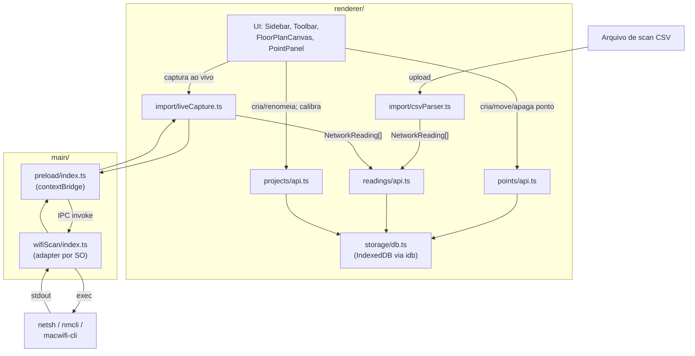
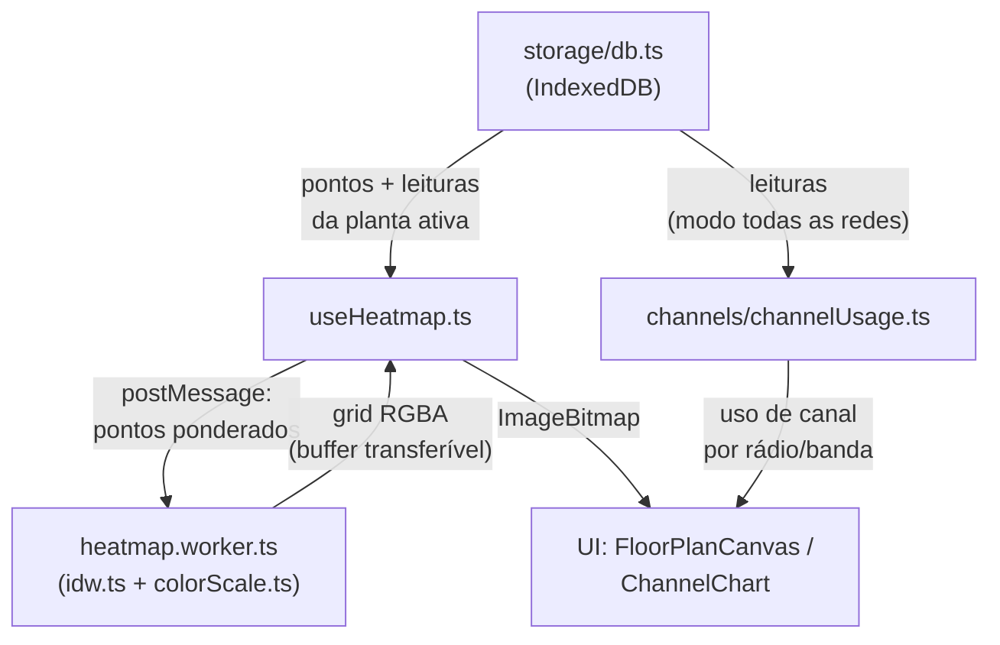

# Architecture & Principles

## 1. Overview

Para contexto de produto, personas, regras de negócio e casos de uso ver [docs/01-prd.md](01-prd.md). Este documento cobre o design técnico do WiFi Viewer: componentes, fluxo de dados, stack, módulos de domínio e princípios arquiteturais.

Projeto em fase de POC, funcional de ponta a ponta com o escopo inicial do PRD implementado (ferramenta pessoal, single-user, distribuída como aplicativo desktop via Electron) — heatmap por IDW, captura ao vivo (Windows/Linux/macOS), importação de CSV, calibração de escala, visão de canais/interferência e sidebar de levantamentos/plantas todos rodando no app real, não só planejados. As seções abaixo descrevem a arquitetura como ela existe hoje em `src/`; a seção 9 (Architecture Decisions) registra como cada peça evoluiu da proposta inicial até o estado atual, incluindo decisões que substituíram por completo a proposta original (ex.: ADR-007, ADR-009/010, ADR-013).

---

## 2. Components

| Serviço      | Runtime                          | Responsabilidade                                                            |
| ------------- | ---------------------------------- | ------------------------------------------------------------------------------ |
| `renderer/`   | React + TypeScript + Vite, executado no Chromium do Electron | UI completa: sidebar de levantamentos/plantas, upload e calibração de escala da planta, marcação/edição de pontos, importação de CSV, captura ao vivo via IPC, cálculo e renderização do heatmap (IDW), visão de canais/interferência, persistência local |
| `main/`       | Electron main process (Node.js + TypeScript) | Ciclo de vida da janela/app, execução da varredura Wi-Fi nativa do SO, exposição de API mínima ao renderer via `preload`/IPC |
| IndexedDB     | Nativo do Chromium (dentro do `renderer/`) | Único armazenamento: projetos, imagens de planta, pontos, leituras            |

Não há backend remoto para os dados de domínio (projetos, pontos, leituras) — ver [ADR-001](#adr-001--arquitetura-client-only-sem-backend) e [ADR-007](#adr-007--electron-como-shell-desktop-em-vez-de-spa-pura-em-navegador). O `main/` não é um servidor de rede: é o processo nativo do próprio app desktop, sem porta HTTP nem CORS, comunicando com o `renderer/` apenas via IPC local.

---

## 3. Data Flow

> Diagrama e descrições abaixo refletem o código atual (verificado em `src/`), não mais a proposta inicial pré-implementação — ver seção 9 (ADRs) para o histórico de como cada peça chegou ao estado atual.

Dividido em dois diagramas menores (captura/persistência e geração de visão) para caber na largura de um painel de markdown normal — o fluxo completo tem nós demais para um único diagrama largo ficar legível.

#### 3a. Captura e persistência

Nota: o export/import de bundle JSON descrito no [ADR-005](#adr-005--exportimport-de-projeto-como-bundle-json-para-portabilidade) é uma decisão registrada, mas **ainda não implementado** no código (sem `exportProject`/`importProject` em nenhum módulo) — por isso não aparece como aresta no diagrama acima; ao ser construído, entra como um par de arestas extra em `Store`.

#### 3b. Geração do heatmap e visão de canais

### Caminho de geração do heatmap

1. Usuário seleciona uma planta e uma rede (SSID agregado, BSSID específico, ou "todas as redes").
2. `Workspace` lê do IndexedDB (via `points/api.ts` e `readings/api.ts`) todos os `MeasurementPoint` da planta e suas `NetworkReading`, e deriva a leitura mais forte por ponto (`pointReadingById`) — da rede selecionada, ou a melhor entre todas no modo "todas as redes" (ADR-011).
3. Para cada ponto, `computeSigmaPx` deriva o raio (sigma) do blob: com a planta calibrada, a partir da distância estimada até a origem (RSSI → distância em `readings/distance.ts`) convertida para pixels via `lib/calibration.ts` (ADR-012); sem calibração, cai no fallback `dbmToSigma` (só o dBm bruto).
4. `useHeatmap.ts` envia os pontos ponderados (`x`, `y`, `valueDbm`, `sigma`) ao Web Worker `heatmap.worker.ts` via `postMessage`.
5. O worker (`idw.ts`) calcula uma grade IDW com dois pesos desacoplados por célula: peso IDW clássico sem teto para o **valor** (garante interpolação exata nos pontos medidos, ADR-024) e peso gaussiano separado para **confiança** e para **intensidade de interpolação** (quantos pontos independentes sustentam cada célula, ADR-031).
6. `colorScale.ts` mapeia cada célula para RGBA: cor via `dbmToColor` (escala térmica azul→vermelho, ADR-020); opacidade combina confiança × força do sinal × intensidade de interpolação (`confidenceToAlpha`, `dbmToAlphaFactor`, ADR-025–031). Longe de qualquer ponto medido a opacidade cai suavemente até 0 (revela a planta por baixo) — cumpre a regra de não extrapolar sinal com a confiança de uma leitura real, mas **não** existe (nem nunca existiu) um padrão hachurado/cinza para "dados insuficientes"; é só desvanecimento de opacidade.
7. O worker devolve o buffer RGBA (transferível); a thread principal monta um `ImageBitmap` (`createImageBitmap`) e `FloorPlanCanvas` o desenha como camada sobre a imagem da planta no `<canvas>` (sem `globalAlpha` extra no desenho — a opacidade final já vem pronta do worker, ver ADR-022).

### 3.1 Importação de leituras: CSV e captura ao vivo convergem em `readings/api.ts`

Os dois caminhos produzem o mesmo formato (`NetworkReading[]`) e terminam na mesma chamada, `addReadings(pointId, readings)` — a leitura persistida (`StoredNetworkReading`) não guarda de qual caminho veio, só um campo `signalSource: "measured" | "estimated"` que distingue dBm real (macOS/CSV) de aproximação por qualidade percentual (Windows/Linux, ver tabela na seção Stack).

- **Importação de arquivo:** `import/csvParser.ts` (`parseWifiScanCsv`) valida estritamente o cabeçalho contra o formato de referência (ver [docs/01-prd.md](01-prd.md), regra de negócio "Importação de dados") — qualquer desvio de colunas lança `CsvImportError`, sem tentativa de parsing heurístico.
- **Captura ao vivo:** ver 3.2 abaixo.

Ambos são disparados a partir do `PointPanel` do ponto selecionado (`Workspace.handleImportCsv` / `Workspace.handleLiveCapture`); falhas em qualquer um dos dois caminhos aparecem no banner `workspace__error`, sem interromper o resto da UI.

### 3.2 Captura ao vivo via IPC no processo main

Diferente do design original baseado em processo `agent/` separado via HTTP (ver ADR-004, substituído pelo ADR-007), a captura ao vivo é uma capacidade nativa do próprio app — o usuário não precisa iniciar nada à parte.

1. Ao montar `Workspace`, o renderer chama `isLiveCaptureAvailable()` (`import/liveCapture.ts` → `window.wifiViewer.isScanAvailable()`); no `main/`, `wifiScan/index.ts` delega a um adapter por `process.platform` (`windowsAdapter`/`linuxAdapter`/`macosAdapter`), cada um checando se seu mecanismo existe no PATH (`where netsh` / `which nmcli` / `which macwifi-cli`).
2. Se indisponível (ex.: distro Linux sem NetworkManager, ou `macwifi-cli` não instalado), o `PointPanel` mantém o botão de captura ao vivo desabilitado e orienta o uso de importação de arquivo — critério de aceite do UC-003 no PRD.
3. Se disponível, o usuário clica em "Captura ao vivo" no `PointPanel` do ponto selecionado; `Workspace.handleLiveCapture` chama `captureLive()` (`import/liveCapture.ts`), que invoca `window.wifiViewer.scanNetworks()` exposto pelo `preload/index.ts` via `contextBridge` (ADR-008).
4. A chamada atravessa o IPC (`ipcRenderer.invoke` → `ipcMain.handle('wifiViewer:scanNetworks')`, `main/index.ts`) até `wifiScan/index.ts`, que executa via `child_process.exec` o comando do adapter da plataforma atual: `netsh wlan show networks mode=bssid` (Windows), `nmcli -t -f SSID,BSSID,SIGNAL,CHAN,SECURITY dev wifi list` (Linux) ou `macwifi-cli scan --json` (macOS, ADR-009/ADR-010 — não é mais `airport`, removido pela Apple).
5. Cada adapter tem um parser dedicado (`windows.ts`/`linux.ts`/`macos.ts`) que normaliza a saída para `NetworkReading[]` — mesmo formato usado pela importação de CSV; entradas sem BSSID (redes "lembradas" fora de alcance, sinal zerado) são descartadas.
6. O renderer recebe a lista via IPC e grava via `readings/api.ts` (`addReadings`), do mesmo jeito que gravaria leituras importadas de um arquivo.
7. Se o comando falhar em tempo de execução (ex.: permissão negada, `macwifi-cli` desinstalado depois do check inicial), o erro é capturado em `Workspace.handleLiveCapture` e mostrado no banner de erro, sem falhar silenciosamente.

---

## 4. Domain Modules

Módulos lógicos do `renderer/`, mais um módulo que vive exclusivamente no `main/`:

| Módulo      | Entidades (IndexedDB)                     | Papel                                                                  |
| ----------- | ------------------------------------------ | ------------------------------------------------------------------------ |
| `projects`  | `Project`, `FloorPlan`                     | Levantamento e imagens de planta; calibração de escala pixel↔metro       |
| `points`    | `MeasurementPoint`                         | Posição de cada ponto de coleta sobre uma planta                         |
| `readings`  | `NetworkReading`                           | Leituras de rede (SSID, BSSID, RSSI, canal, frequência, segurança, padrão) vinculadas a um ponto |
| `import`    | — (parser/validador, sem entidade própria) | Parsing e validação de arquivos de scan no formato de referência; adapter que também consome a captura ao vivo via IPC |
| `heatmap`   | — (motor IDW, escala de cores)             | Interpolação de sinal e renderização do heatmap em Canvas/Worker         |
| `channels`  | — (view de agregação)                      | Agrupamento de redes por banda/canal para a visão de interferência        |
| `storage`   | — (camada IndexedDB, `idb`)                | Persistência local de projetos, plantas, pontos e leituras. Export/import de bundle JSON para portabilidade entre dispositivos (ADR-005) é uma decisão registrada, **ainda não implementada** |
| `wifiScan` (processo `main/`) | — (sem entidade própria)  | Executa o comando de varredura nativo do SO e normaliza a saída para `NetworkReading`; único módulo exposto ao renderer via IPC/`contextBridge` |

---

## 5. Observability

Dado o escopo de ferramenta pessoal, single-user e sem backend remoto, não há pipeline de telemetria (OTLP/tracing/dashboards). Erros do `renderer/` são reportados via UI (toasts/console); erros do `main/` (ex.: falha ao executar o comando de varredura) podem ser logados localmente (ex.: `electron-log`) para depuração, sem envio a serviço externo. Se o projeto crescer para múltiplos usuários ou ganhar um backend remoto, este documento deve ser revisitado para incluir uma estratégia de observabilidade real.

---

## 6. Stack

### Linguagens e runtimes

| Camada         | Linguagem              | Versão            |
| --------------- | ----------------------- | ------------------ |
| Renderer        | TypeScript              | 5.x                |
| Main process    | TypeScript (Node.js)    | Node 20 (embutido pelo Electron) |
| Shell desktop   | Electron                | última estável (30.x+) |

### `renderer/` (TypeScript + React)

- **React + Vite** — build da UI; roda dentro do Chromium empacotado pelo Electron (não em um navegador comum).
- **Canvas API (nativa)** — renderização da planta, marcadores de pontos e composição da camada de heatmap.
- **Web Worker (nativo)** — cálculo de interpolação IDW fora da thread principal, evitando travar a UI ao marcar/editar pontos.
- **`idb`** — wrapper tipado sobre IndexedDB para persistência de projetos, imagens de planta (blobs), pontos e leituras.
- **Parser próprio** (`import/csvParser.ts`, sem dependência externa) — leitura do arquivo de scan delimitado (formato de referência descrito no PRD, regra de negócio "Importação de dados") em linhas tipadas; `papaparse` nunca chegou a ser usado na prática.
- **Zustand** (`store/uiStore.ts`) — só o estado de UI verdadeiramente global (ponto selecionado, rede selecionada). Estado de tela (zoom, pan, calibração pendente, sidebar colapsada, legenda expandida) fica em `useState` local do próprio componente, não centralizado no store.
- **SVG nativo** (sem lib externa) — gráfico de distribuição de canais (`channels/channelUsage.ts` + componente de visualização).

### `main/` (Electron main process, Node.js + TypeScript)

- **Electron** — processo principal com acesso nativo ao SO; gerencia a janela (`BrowserWindow`) que carrega o `renderer/`; empacotamento de instaláveis via `electron-builder`.
- **`preload/` + `contextBridge`** — única superfície exposta ao renderer (`contextIsolation: true`, `nodeIntegration: false`); ver ADR-008.
- **`node:child_process`** (nativo) — executa o comando/binário de varredura do SO e captura o stdout.
- Sem dependências de build/empacotamento próprias além do Electron — mantém o processo main pequeno e fácil de auditar. A varredura no macOS depende de uma ferramenta externa já instalada no sistema (ver abaixo e ADR-009), não de código compilado por este projeto.

**Varredura por sistema operacional:**

| SO      | Mecanismo                                                    | Sinal reportado                          | Observações                                                                 |
| ------- | ------------------------------------------------------------ | ------------------------------------------ | -------------------------------------------------------------------------------- |
| Windows | `netsh wlan show networks mode=bssid`                        | Qualidade em % → convertida para dBm estimado (`dBm ≈ quality/2 − 100`) | Não requer privilégio elevado                                                    |
| Linux   | `nmcli -t -f SSID,BSSID,SIGNAL,CHAN,SECURITY dev wifi list`   | Qualidade em % → convertida para dBm estimado (mesma fórmula) | Não requer root via NetworkManager; alternativa `iw dev <iface> scan` dá dBm real mas exige `sudo` |
| macOS   | `macwifi-cli scan --json` (ferramenta externa, não deste projeto) | dBm real (RSSI)                            | `airport -s` foi removido pela Apple (confirmado ausente no Darwin 25.x); um helper próprio em Swift/CoreWLAN foi tentado e **confirmado inviável sem assinatura Developer ID paga** (Gatekeeper rejeita binários ad-hoc). `macwifi-cli` já resolve isso porque seu autor assina e notariza os binários que distribui — ver ADR-009. Requer `brew install jaisonerick/tap/macwifi-cli` e permissão de Localização concedida uma vez (diálogo do próprio SO) |

Cada leitura normalizada carrega um campo `signalSource: "measured" | "estimated"` para o heatmap poder, no futuro, distinguir visualmente sinal medido (macOS) de sinal aproximado por qualidade percentual (Windows/Linux) — hoje ambos são tratados com a mesma confiança, mas o campo já fica disponível no schema.

### Datastores

| Store               | Versão | Uso                                                                 |
| -------------------- | ------ | ---------------------------------------------------------------------- |
| IndexedDB (Chromium, dentro do `renderer/`) | — | Única fonte de persistência: projetos, imagens de planta, pontos, leituras |

### Infraestrutura

- Sem backend remoto — o app é empacotado como executável desktop via `electron-builder` (`.dmg`/`.exe`/`.AppImage`).
- MVP roda a partir do código-fonte (`npm run dev`) ou de builds gerados por `npm run build` (`electron-builder`), não assinados/não notarizados para uso pessoal; assinatura de código (macOS Gatekeeper, Windows SmartScreen) fica deliberadamente fora de escopo por ora — ver Out of Scope no PRD.
- Sem Docker/compose no MVP (não há serviços a orquestrar).
- Sem variáveis de ambiente/segredos — app roda inteiramente local, sem chamadas a APIs externas autenticadas.

### Convenções

- Coordenadas de pontos são armazenadas em espaço de pixel relativo à imagem original da planta; conversão para metros só é aplicada na camada de exibição/calibração quando uma escala foi definida.
- Força de sinal sempre armazenada e exibida em dBm (inteiros negativos); a escala de cores do heatmap usa limiares fixos documentados no módulo `heatmap` (ex.: ≥ -50dBm verde ... ≤ -80dBm vermelho).
- Timestamps armazenados em ISO 8601 UTC; formatação de exibição é responsabilidade da camada de apresentação.
- Importação de arquivo de scan é estrita: contagem/ordem de colunas fora do formato de referência é rejeitada com erro explícito, sem tentativa de adivinhação heurística.
- Testes com Vitest, sem Testing Library nem testes de componente/DOM ainda — cobertura hoje é 100% lógica pura: `heatmap` (`idw.test.ts`, `colorScale.test.ts`), `import` (`csvParser.test.ts`), `channels` (`channelUsage.test.ts`), `readings` (`distance.test.ts`, `network.test.ts`) e o parser macOS do `wifiScan` (`macos.test.ts`).

---

## 7. Architecture Principles

- **Sem backend remoto por padrão.** Nenhuma funcionalidade do MVP deve exigir um servidor de rede. O `main/` do Electron roda localmente, sem porta HTTP nem chamadas de rede; se uma feature futura realmente precisar de servidor (ex.: sincronização multi-dispositivo em tempo real), isso é uma mudança arquitetural deliberada, não um acréscimo incremental.
- **IPC é a única ponte para o SO.** Toda capacidade que dependa do sistema operacional (hoje: varredura Wi-Fi) passa exclusivamente pelo `preload`/`contextBridge`; o renderer nunca tem acesso direto a Node.js ou `child_process` — ver ADR-008.
- **Importação de arquivo é o caminho principal, nunca dependente de captura ao vivo.** Toda funcionalidade central (heatmap, canais, pontos) deve funcionar 100% a partir de arquivos importados; captura ao vivo é aditiva.
- **Falha explícita na importação.** Um arquivo fora do formato de referência é rejeitado com mensagem clara — nunca é parseado de forma best-effort/heurística que possa gerar dados errados silenciosamente.
- **Interpolação nunca disfarça ausência de dados como sinal medido.** Áreas fora do raio de confiança dos pontos coletados são sempre visualmente distintas de sinal fraco confirmado.
- **Coordenadas em espaço de pixel são a fonte da verdade.** A escala em metros é uma conversão de exibição opcional, nunca o dado primário armazenado — evita recomputações destrutivas se a calibração mudar.
- **Sem estado mutável paralelo.** IndexedDB é a única fonte de verdade; o estado de UI (Zustand/Context) é sempre derivado, nunca a origem dos dados de projeto.

---

## 8. Development Guidelines

O projeto passou a ter `CLAUDE.md` e `AGENTS.md` (guia de contexto/contribuição para uso humano e assistido) com um Gitflow formal (modelo padrão de mercado): `feature/*` nasce de `develop` e volta para `develop` via PR; `release/*` nasce de `develop` para fechar um ciclo e mergeia em `main` (com tag semântica, ex. `v0.1.0`) e de volta em `develop`; `hotfix/*` nasce de `main` para correções urgentes e mergeia em `main` e `develop`. Segue:

- TypeScript em modo `strict`; sem `any` implícito.
- Testes unitários (Vitest) obrigatórios para módulos de lógica pura de maior risco de regressão silenciosa — hoje cobertos: `heatmap`, `import`, `channels`, `readings`.
- Testes do `main/` (`wifiScan`) testam só os parsers puros com strings de saída fixas (ex.: `macos.test.ts` → `parseMacwifiCliOutput`) — não há mock de `child_process` porque o teste nunca chega a executar o comando de verdade, então não depende de hardware Wi-Fi real. Hoje só o parser macOS tem teste; `windows.ts`/`linux.ts` ainda não têm.
- Sem segredos/chaves de API no repositório — a aplicação não faz chamadas autenticadas a serviços externos.
- Rodar `npm run typecheck && npm test` antes de abrir PR (ver `AGENTS.md`).
- Commits pequenos e descritivos (português ou inglês, formato imperativo — `feat: ...`, `fix: ...`); PR para `develop` (ou `main` no caso de `release/*`/`hotfix/*`) usando o template em `.github/PULL_REQUEST_TEMPLATE.md`. Deixou de ser "projeto pessoal sem processo formal de PR/review" — o Gitflow acima é o processo vigente, mesmo em fase de POC.

---

## 9. Architecture Decisions

### ADR-001 — Arquitetura client-only (sem backend remoto)
**Contexto:** ferramenta de uso individual, sem necessidade de estado compartilhado entre usuários.
**Decisão:** construir sem servidor de rede, usando IndexedDB (no processo `renderer/`) em vez de servidor + banco de dados.
**Motivo:** elimina custo e complexidade de infraestrutura para uma ferramenta single-user.
**Consequência:** os dados vivem apenas na instalação do app que os criou; acesso entre dispositivos exige exportação/importação manual de um bundle do projeto (ver ADR-005). O empacotamento concreto como app desktop (Electron, em vez de página web pura) é detalhado no ADR-007.

### ADR-002 — Heatmap via IDW calculado no cliente (Web Worker + Canvas)
**Contexto:** necessidade de visualizar força de sinal sobre a planta a partir de um conjunto esparso de pontos marcados manualmente.
**Decisão:** Inverse Distance Weighting computado em um Web Worker, renderizado como camada de cor sobre Canvas.
**Motivo:** IDW é simples, determinístico e adequado ao volume de pontos típico de um levantamento manual; o Worker evita travar a UI durante o recálculo a cada edição de ponto.
**Consequência:** sem round-trip a servidor para gerar o heatmap; conjuntos muito grandes de pontos (milhares) poderiam exigir otimização futura, não esperada neste escopo.

### ADR-003 — Posicionamento manual em vez de automático
**Contexto:** não há hardware/API confiável para posicionamento indoor automático (GPS não funciona bem em ambiente interno; BLE/triangulação exigiriam infraestrutura adicional fora de escopo).
**Decisão:** posição de cada ponto é definida por clique do usuário na planta, armazenada em coordenadas de pixel.
**Motivo:** evita a complexidade e a imprecisão de soluções de posicionamento indoor automático para um caso de uso pontual e pessoal.
**Consequência:** precisão do heatmap depende da precisão do usuário ao marcar o ponto; a UI deve tornar reposicionamento e recalibração triviais.

### ADR-004 — Captura ao vivo via agente local Node.js expondo HTTP em localhost
> **Status:** Substituído pelo [ADR-007](#adr-007--electron-como-shell-desktop-em-vez-de-spa-pura-em-navegador). Mantido como histórico da decisão original (SPA em navegador + processo `agent/` separado).

**Contexto:** navegadores não expõem uma API padrão para varredura de redes Wi-Fi (é uma capacidade de SO, não da web platform); a importação de arquivo continua sendo o caminho obrigatório e suficiente para o MVP.
**Decisão:** captura ao vivo é servida por um processo `agent/` separado, em Node.js/TypeScript (mesma linguagem do `web/`), que expõe `GET /health` e `GET /scan` em `http://127.0.0.1`, executando o comando nativo de varredura do SO (`netsh`/`nmcli`/`airport`) e normalizando a saída para o mesmo formato de leitura usado pela importação de CSV.
**Motivo:** Node.js mantém o projeto em uma única linguagem (em vez de escrever o agente em Go); um processo HTTP local é mais simples de implementar e depurar do que uma extensão de navegador com Native Messaging, e não exige publicar/instalar extensão nenhuma.
**Consequência:** o usuário precisa iniciar o agente manualmente para usar captura ao vivo (sem instalação como serviço do SO); a UI trata sua ausência como caso normal, não como erro (já coberto pelo UC-003). Em macOS, o agente pode depender de permissão de Localização concedida ao processo. Em Windows/Linux, o sinal reportado é uma aproximação de dBm derivada de qualidade percentual, não uma medição direta — ver campo `signalSource`.

### ADR-005 — Export/import de projeto como bundle JSON para portabilidade
**Contexto:** armazenamento client-only (IndexedDB) isola os dados por instalação/dispositivo.
**Decisão:** suportar exportação do projeto completo (imagens de planta, calibração, pontos e leituras) como um único arquivo baixável (JSON com imagens em base64), e reimportação a partir desse arquivo.
**Motivo:** fornece um mecanismo manual de backup e compartilhamento sem precisar de backend, respeitando o não-objetivo de multiusuário do PRD e ainda permitindo mover dados entre máquinas.
**Consequência:** não há sincronização em tempo real; o bundle exportado pode ficar desatualizado se o projeto for editado em dois lugares diferentes.

### ADR-006 — Agente local restringe CORS por origem em vez de exigir token de autenticação
> **Status:** Obsoleto — substituído pelo [ADR-008](#adr-008--ipc-restrito-via-contextbridge-contextisolation-ativado-nodeintegration-desativado). Sem processo `agent/` nem porta HTTP local, não há mais superfície de CORS a proteger. Mantido como histórico.

**Contexto:** o `agent/` escuta apenas em `127.0.0.1`, mas qualquer aba do navegador (não só a SPA do WiFi Viewer) ou processo local pode, em teoria, chamar `GET /scan` enquanto o agente estiver rodando — um risco de baixa sensibilidade (lista de SSIDs/BSSIDs próximos), mas ainda assim uma divulgação de informação local não intencional.
**Decisão:** o agente responde apenas a requisições cuja origem (`Origin` header) esteja na allowlist configurada (padrão: a origem onde a SPA é servida, ex.: `http://localhost:5173` em dev); não implementa autenticação por token compartilhado no MVP.
**Motivo:** para uma ferramenta pessoal de baixa sensibilidade, restrição de CORS já elimina o vetor mais comum (uma página web arbitrária lendo o endpoint); um token adicionaria fricção de setup (copiar/colar segredo) desproporcional ao risco.
**Consequência:** o agente não protege contra outro processo nativo local (não-navegador) que chame o endpoint diretamente ignorando CORS — aceito como risco residual dado o escopo pessoal e a natureza não sensível do dado exposto. Se o produto deixar de ser single-user, esta decisão deve ser revisitada.

### ADR-007 — Electron como shell desktop em vez de SPA pura em navegador
**Contexto:** o design original (ADR-004) usava a SPA em um navegador comum mais um processo `agent/` Node.js separado, comunicando-se via HTTP em `localhost`, apenas para contornar a ausência de API de varredura Wi-Fi no navegador. Isso exigia o usuário iniciar dois processos e introduzia uma superfície de confiança via CORS (ADR-006) só para viabilizar a captura ao vivo. Além disso, ferramentas de referência citadas no PRD (NetSpot, Ekahau) são apps desktop nativos, não web + helper.
**Decisão:** empacotar a aplicação como app desktop Electron: um processo `main/` (Node.js, acesso nativo ao SO) e um processo `renderer/` (a mesma SPA React/TypeScript, rodando em Chromium), comunicando-se via IPC (`contextBridge`) em vez de HTTP local.
**Motivo:** elimina o processo `agent/` separado e a necessidade de iniciá-lo manualmente; a captura ao vivo passa a ser uma capacidade nativa e sempre tentada do app, sem depender de CORS/allowlist de origem; alinha o produto ao modelo real das ferramentas de referência.
**Consequência:** o app deixa de ser "abra no navegador, zero instalação" e passa a ser um executável desktop buildado via `electron-builder`. Empacotamento de instaladores assinados/notarizados (macOS/Windows) fica deliberadamente fora de escopo por ora — rodar a partir do código-fonte é suficiente para uso pessoal (ver Out of Scope no PRD). Substitui o ADR-004 e torna o ADR-006 obsoleto.

### ADR-008 — IPC restrito via contextBridge (contextIsolation ativado, nodeIntegration desativado)
**Contexto:** o processo `renderer/` executa conteúdo web (React) e precisa disparar a varredura Wi-Fi do SO, que só o processo `main/` pode executar via `child_process`; expor Node.js diretamente ao renderer criaria uma superfície de risco desnecessária (qualquer código rodando na página, inclusive dependências de terceiros, ganharia acesso irrestrito ao SO).
**Decisão:** `contextIsolation: true` e `nodeIntegration: false` na `BrowserWindow`; o preload script expõe, via `contextBridge.exposeInMainWorld`, apenas uma API mínima e tipada (`window.wifiViewer.scanNetworks()`, `window.wifiViewer.isScanAvailable()`) — nunca acesso genérico a `child_process`/`fs`.
**Motivo:** segue a prática recomendada pelo próprio Electron para isolar o conteúdo web do sistema operacional.
**Consequência:** toda nova capacidade que precise do SO (ex.: leitura de arquivo nativa, futura integração) exige um canal IPC explícito e documentado no preload — não há atalho para "chamar Node diretamente" a partir da UI.

### ADR-009 — Helper nativo Swift/CoreWLAN próprio: tentado e abandonado (assinatura ad-hoc não é viável)
> **Status:** Abandonado — substituído pelo [ADR-010](#adr-010--macwifi-cli-como-dependência-externa-para-captura-ao-vivo-no-macos). Mantido como registro da investigação empírica, que motivou diretamente a decisão do ADR-010.

**Contexto:** `airport -s` (usado no design original) foi confirmado ausente em versões recentes do macOS (testado e ausente no Darwin 25.x) — a Apple removeu a ferramenta sem substituto em linha de comando. `wdutil info` existe mas exige `sudo` e só reporta a rede já conectada, não uma varredura de vizinhas; `system_profiler SPAirPortDataType` não retorna dados de varredura sem permissão. CoreWLAN é a única API restante capaz de varrer redes vizinhas.

**Decisão (abandonada):** um helper Swift (`src/main/wifiScan/mac-helper/scan.swift`, removido) chamava `CWInterface.scanForNetworks` e imprimia JSON no stdout; compilado via `swiftc` e empacotado como `.app` (com `Info.plist` próprio) por `scripts/build-mac-helper.mjs` (removido), assinado apenas ad-hoc (`codesign -s -`, sem Team ID pago).

**Motivo:** era a única forma aparente de obter uma varredura real no macOS atual sem custo — mas ver Consequência: a investigação mostrou que isso **não funciona de forma confiável**.

**Consequência (investigação empírica extensa, todas confirmadas nesta máquina — macOS 26 / Darwin 25.5.0):**
- Um binário solto (sem bundle) nunca sai do estado "not determined": a permissão de Localização do processo pai (Electron) **não se propaga** para um filho sem bundle próprio.
- Empacotado como `.app` com `Info.plist`/`CFBundleIdentifier` próprio e assinado ad-hoc, o diálogo de permissão **passa a aparecer de verdade** e pode ser aceito pelo usuário (confirmado repetidas vezes, inclusive com o delegate do `CLLocationManager` reportando `.authorizedAlways` na hora).
- Mesmo assim, uma nova execução do binário (processo fresco, depois da concessão já confirmada) **volta a reportar "not determined"** na maioria das vezes — a concessão não persiste de forma confiável entre execuções.
- `spctl -a -vv` mostra esse `.app` como **`rejected` pelo Gatekeeper** (assinatura ad-hoc não é suficiente para o Gatekeeper aceitar o binário).
- `spctl --add` (mecanismo clássico de exceção manual do Gatekeeper) foi **descontinuado pela Apple** nesta versão do SO ("This operation is no longer supported").
- `spctl developer-mode enable-terminal` + habilitar Terminal em Ajustes → Privacidade e Segurança → Ferramentas de Desenvolvedor foi testado como último recurso gratuito: não resolveu.
- **Confirmação decisiva:** instalado `macwifi-cli` (ferramenta de terceiro que resolve o mesmo problema) via Homebrew para comparação. Seu binário auxiliar (`WifiScanner.app`) está assinado com **Developer ID Application real e notarizado** (`codesign -dv` mostra `Authority=Developer ID Application`, `Notarization Ticket=stapled`; `spctl -a -vv` retorna `accepted`) — e com ele a varredura devolve SSID/BSSID/RSSI reais imediatamente, sem nenhuma das instabilidades observadas com o binário ad-hoc. Isso isola definitivamente a causa: **assinatura Developer ID paga, não a lógica do código**, é o que faltava.

**Conclusão:** manter um helper Swift próprio exigiria pagar Apple Developer Program (~US$99/ano) e configurar assinatura + notarização — ver [ADR-010](#adr-010--macwifi-cli-como-dependência-externa-para-captura-ao-vivo-no-macos) para a decisão tomada em vez disso.

### ADR-010 — `macwifi-cli` como dependência externa para captura ao vivo no macOS
**Contexto:** o ADR-009 confirmou que um helper próprio funciona tecnicamente (mesma API CoreWLAN) mas fica bloqueado pelo Gatekeeper sem assinatura Developer ID paga. `macwifi-cli` ([jaisonerick/macwifi-cli](https://github.com/jaisonerick)) é uma ferramenta de terceiro, de código aberto, que resolve exatamente esse problema — seu autor assina e notariza os binários que distribui via Homebrew (`brew install jaisonerick/tap/macwifi-cli`), então a permissão de Localização é concedida uma vez e persiste normalmente.

**Decisão:** o adapter macOS (`src/main/wifiScan/macos.ts` + `index.ts`) não compila/empacota mais nada — apenas verifica se `macwifi-cli` está no PATH (`which macwifi-cli`, mesmo padrão do `netsh`/`nmcli`) e roda `macwifi-cli scan --json`, parseando a saída JSON para o formato `NetworkReading`. Entradas de redes "lembradas" mas fora de alcance (bssid vazio, valores zerados) são descartadas.

**Motivo:** resolve captura ao vivo no macOS sem o WiFi Viewer precisar de conta Apple Developer, assinatura ou notarização própria — o custo/complexidade de assinatura já foi pago pelo autor do `macwifi-cli`. Mesmo modelo de dependência que Windows (`netsh`) e Linux (`nmcli`): uma ferramenta externa esperada no sistema, não algo que este projeto constrói ou assina.

**Consequência:** captura ao vivo no macOS agora depende da instalação manual do `macwifi-cli` pelo usuário (`isScanAvailable()` retorna `false` e a UI orienta a usar importação de arquivo se não estiver instalado — já é o comportamento padrão para "mecanismo indisponível"). Também introduz uma dependência de manutenção de terceiro: se o projeto `macwifi-cli` for descontinuado ou mudar seu formato de saída, o parser (`parseMacwifiCliOutput`) precisará ser atualizado. Aceito como troca razoável dado o custo zero e a confirmação empírica de que funciona de forma estável.

### ADR-011 — Heatmap "todas as redes": camadas por cor, misturadas, com espalhamento proporcional ao sinal
**Contexto:** o heatmap original só suportava uma rede selecionada por vez (cor derivada do valor dBm via `dbmToColor`). O PRD passou a exigir uma visão comparando todas as redes de uma vez, cada uma com uma cor própria, para entender cobertura geral do prédio (UC-005).
**Decisão:** `idw.WeightedPoint` ganhou um campo opcional `sigma` por ponto (em vez de um único sigma global). O worker (`heatmap.worker.ts`) passou a aceitar um modo `layers`: computa uma grade IDW por rede (com sigma por ponto proporcional à força do sinal, via `colorScale.dbmToSigma`), converte cada uma para RGBA com a cor fixa daquela rede (`gridToTintedRgba`), e compõe todas as camadas com blending "over" (`compositeRgbaLayers`) — cores se misturam nas sobreposições em vez de uma vencedora ser escolhida. Cores por rede são estáveis via ângulo dourado (`networkColor`, `hue = index × 137.508°`), não por hash do nome, para manter distinção visual mesmo com poucas redes.
**Motivo:** decisão explícita do usuário do produto: sobreposição deveria misturar cores (não "melhor rede vence"), e a força do sinal deveria aparecer como o alcance/tamanho do blob de cada ponto, já que a cor ali identifica a rede, não a intensidade.
**Consequência:** o campo `sigma` por ponto é opcional — quando ausente, cai no sigma uniforme da grade. Calcular N grades (uma por rede) ao invés de uma é mais trabalho para o worker, mas o volume de pontos esperado (levantamento manual pessoal) é pequeno o suficiente para não importar na prática. **Atualização (ver ADR-012):** o modo "rede única" passou a usar sigma por ponto também, pelo mesmo motivo — a decisão inicial de "só a visão de todas as redes varia o sigma" durou pouco.

### ADR-012 — Sigma do heatmap derivado da distância estimada até a origem (calibração-aware), não mais só do dBm
**Contexto:** o sigma por ponto (ADR-011) mapeava o dBm bruto para um raio em pixels usando limites arbitrários (`dbmToSigma`, 40–150px fixos), igual em qualquer planta — sem relação com a escala real do prédio. O usuário observou (com a planta calibrada) que o raio deveria refletir uma noção física real de alcance, e perguntou se dava pra estimar a distância até o access point a partir do RSSI para melhorar isso — o próprio formato de CSV de referência já carrega um campo "Distance" com exatamente esse tipo de estimativa (calculada pela ferramenta de origem via path loss).
**Decisão:** `readings/distance.ts` adiciona `estimateDistanceFromRssi` (modelo log-distance path loss: `10^((RSSI@1m − RSSI)/(10·n))`, com RSSI@1m=-40dBm e n=3 como valores de referência para ambiente interno) e `getDistanceMeters(reading)`, que usa a distância informada pela fonte (CSV) quando existe, senão estima via RSSI (leituras de captura ao vivo não trazem esse campo). `colorScale.distanceToSigmaMeters` mapeia essa distância (clampada 1–40m) para um sigma em metros (8m perto, 1m longe — inverso, ver Motivo). Com a planta calibrada, `lib/calibration.getPixelsPerMeter` converte para pixels; sem calibração, cai no fallback antigo `dbmToSigma` (não dá pra converter metros em pixels sem escala). Aplicado tanto no modo rede única quanto em "todas as redes" (`Workspace.computeSigmaPx`), e a distância também é exibida na tabela de leituras do `PointPanel` (com indicação "(estimado)" quando calculada, não informada pela fonte).
**Motivo:** perto da origem, o ponto está dentro de uma área de boa cobertura (o resto do cômodo provavelmente também está bem coberto) — blob maior comunica isso; longe, a leitura é mais pontual/sujeita a multipercurso e não deveria ser extrapolada com confiança para uma área grande — blob menor. Mantém a mesma direção de efeito visual já decidida no ADR-011 (sinal forte → blob maior), só que agora fundamentada numa estimativa física real em vez de limites de pixel inventados, e coerente com a escala real da planta quando calibrada.
**Consequência:** a estimativa por RSSI é reconhecidamente grosseira (não modela paredes/multipercurso reais) — tratada como ordem de grandeza, igual ao campo "Distance" do CSV, nunca como medição precisa nem para posicionar automaticamente nada (ver PRD, regra "Pontos de medição"). `dbmToSigma` continua existindo como fallback para plantas não calibradas.

### ADR-013 — Marcador do ponto tem tamanho fixo; modal próprio substitui `window.prompt()` na calibração
**Contexto:** dois problemas relatados testando o app empacotado de verdade (não só no preview do navegador): (1) o marcador numerado do ponto estava variando de tamanho junto com o sigma do heatmap (ADR-011/012) — confuso, já que o próprio heatmap já comunica a força do sinal; o marcador deveria ser só uma referência de localização. (2) A calibração de escala não funcionava no app real: ao clicar no segundo ponto, nada acontecia. Causa: o fluxo usava `window.prompt()` para pedir a distância real, e **o Electron não implementa o diálogo nativo de prompt** (só `alert`/`confirm` têm suporte real) — a chamada retornava vazio silenciosamente, sem nunca mostrar nada na tela. Isso só não apareceu nos testes anteriores porque a verificação foi feita via preview num navegador comum (Chromium via Playwright), que suporta `window.prompt()` normalmente — o bug era invisível fora do Electron real.
**Decisão:** o raio do marcador numerado (`FloorPlanCanvas`) voltou a ser uma constante única (`POINT_RADIUS`) para todos os pontos, independente de sinal — `dbmToRadius` foi removido (ficou sem uso). A calibração passou a usar um modal React próprio (`components/CalibrationDialog.tsx`, `<input>` + validação inline) em vez de `window.prompt()`; os dois cliques de referência só abrem o modal depois de coletados (`pendingCalibrationPoints.length === 2`), sem depender de nenhuma API de diálogo nativa.
**Motivo:** um modal HTML/React comum não tem diferença de suporte entre navegador e Electron (ambos são Chromium renderizando DOM normal) — elimina de vez essa classe de bug para qualquer fluxo futuro que precise coletar texto do usuário. Separar "marcador = localização" de "heatmap = intensidade" evita comunicar a mesma informação (força do sinal) de duas formas diferentes na mesma tela.
**Consequência:** `window.confirm()` (usado no reset de pontos) continua sendo nativo do Electron normalmente — não é o mesmo caso do `prompt`, mas fica registrado aqui que qualquer necessidade futura de coletar **texto livre** do usuário deve usar um modal próprio, nunca `window.prompt()`. Testes visuais só pelo preview do navegador não teriam pego esse bug — vale lembrar que fluxos que usam diálogos nativos do SO precisam ser verificados no Electron real quando possível.

### ADR-014 — Legenda clicável para ampliar (sem novo estado de domínio)
**Contexto:** com muitas redes visíveis no modo "todas as redes", a legenda no canto inferior direito (`components/Legend.tsx`) fica ilegível — texto pequeno, cores espremidas numa caixa de `max-height` fixo com scroll interno.
**Decisão:** `Legend` ganhou um `useState<boolean>` local (`expanded`), alternado por clique/Enter/Espaço no próprio contêiner da legenda (`role="button"`, `tabIndex={0}`). Quando expandida, uma classe modificadora (`.legend--expanded`) aumenta fonte, swatches e `max-width`/`max-height` via CSS puro — sem novos props, sem persistir a preferência, sem tocar em nenhum módulo de domínio.
**Motivo:** é puramente um problema de apresentação (texto cabendo na tela), não um dado que precise sobreviver a um reload ou ser compartilhado entre componentes — estado local resolve sem inflar a store do Zustand ou o schema do IndexedDB.
**Consequência:** o modo `single` (gradiente dBm→cor) também ganhou o mesmo comportamento por consistência, mesmo tendo menos informação a mostrar — clicar amplia a barra e a fonte dos rótulos `-90dBm`/`-30dBm`.

### ADR-015 — Sidebar de projetos/plantas substitui a seleção implícita de "o mais recente"
**Contexto:** `App.tsx` sempre carregava o último projeto criado (`listProjects().at(-1)`) e sua primeira planta — não havia forma de ver ou trocar entre projetos/plantas existentes, nem de adicionar uma planta a um projeto já criado, exigindo esse tipo de navegação múltipla como no NetSpot.
**Decisão:** `App.tsx` agora carrega todos os projetos e o mapa `projectId → FloorPlan[]` de uma vez, e renderiza uma `Sidebar` fixa à esquerda (estilo escuro, à parte do `Workspace`) listando cada projeto com suas plantas; clicar numa planta troca a seleção ativa. Dois pontos de entrada para criação, ambos reaproveitando o mesmo `NewFloorPlanDialog` (modal, não mais só a tela cheia de onboarding do `ProjectSetup`): o botão "+" no cabeçalho da sidebar cria um projeto novo (pede nome do projeto + primeira planta juntos, como o fluxo original), e "+ Nova planta" dentro de cada projeto cria só uma planta nele (reaproveita `createProject`/`createFloorPlan` de `projects/api.ts`, que já suportavam múltiplas plantas por projeto desde o início — faltava só a UI). `ProjectSetup` (tela cheia) continua existindo só para o estado vazio de verdade (zero projetos).
**Motivo:** o modelo de dados (`FloorPlan.projectId`, índice `byProject`) já suportava N plantas por projeto desde a primeira versão — essa mudança é 100% de navegação/UI, sem migração de schema. Trocar de planta remonta o `Workspace` inteiro (`key={floorPlan.id}`) em vez de tentar sincronizar seu estado interno (pontos, banda, calibração pendente) entre plantas diferentes — mais simples e evita vazamento de estado de uma planta para outra.
**Consequência:** a seleção global de ponto/rede (`store/uiStore.ts`, que não é escopada por planta) é resetada explicitamente (`selectPoint(null)`, `selectNetwork(null)`) em toda troca de planta/projeto e após criar uma nova, pra não deixar um ID de ponto ou chave de rede de uma planta "vazando" visualmente pra outra que não tem esse ponto/rede. Não há (ainda) exclusão de projeto/planta pela sidebar — fora do escopo pedido; se precisar, é a próxima extensão natural desse componente.

### ADR-016 — `window.confirm()` também substituído por modal próprio (reset de pontos)

**Contexto:** usuário relatou que, depois de "Resetar pontos" no app empacotado, clicar na planta para criar o próximo ponto não abria o painel de captura — precisava de um segundo clique. O ADR-013 já tinha corrigido `window.prompt()` (não suportado pelo Electron) mas concluiu que `window.confirm()` "continua sendo nativo do Electron normalmente" e não precisava de modal próprio; `handleResetPoints` em `Workspace.tsx` era o único uso restante de um diálogo nativo no app.
**Decisão:** `window.confirm()` do reset de pontos foi substituído por um modal React próprio (mesmo padrão de `.modal-overlay`/`.modal` do `CalibrationDialog`), controlado por um `useState<boolean>` local (`confirmingReset`).
**Motivo:** diferente do `prompt()` (que simplesmente não existe no Electron e retorna vazio), o `confirm()` nativo *funciona* — mostra o diálogo e retorna o valor certo — mas no macOS ele é uma sheet modal do sistema que tira o foco da janela do Electron; ao fechar, o clique seguinte na `<canvas>` só reativa a janela em vez de ser entregue como evento de clique real, exigindo um segundo clique para de fato criar o ponto. Esse comportamento é uma particularidade de foco de janela do SO/Electron com diálogos nativos, não algo que o preview num navegador comum reproduz (não há essa perda de foco de janela num diálogo `confirm()` de aba de navegador) — por isso não foi pego na verificação anterior via preview.
**Consequência:** revisa a conclusão do ADR-013 de que `window.confirm()`/`window.alert()` "são fine" no Electron — na prática, **qualquer diálogo nativo bloqueante (`alert`, `confirm`, `prompt`) é arriscado no Electron empacotado**, seja por falta de suporte (prompt) ou por efeito colateral de foco de janela (confirm/alert, mais visível no macOS). Lição atualizada para o projeto: preferir sempre um modal React próprio a qualquer diálogo nativo do navegador, mesmo quando o diálogo "funciona" tecnicamente. Não há mais nenhum uso de `window.confirm/alert/prompt` no renderer.

### ADR-017 — Tabela de leituras do `PointPanel` com `table-layout: fixed` (painel vazava para fora da janela)

**Contexto:** usuário reportou (com screenshot do app real) que o painel de captura ("janela de captura") aparecia com texto cortado bruscamente na borda direita — botões como "Importar arquivo de scan" e colunas da tabela de leituras terminavam no meio da palavra, sem quebra de linha nem barra de rolagem, como se o conteúdo simplesmente "ultrapassasse o viewport". Reproduzido isolando o cenário: a tabela de leituras (`PointPanel.tsx`, colunas SSID/BSSID/dBm/Canal/Distância/Segurança) usava `table-layout: auto` (padrão do navegador) com `white-space: nowrap` em todas as células — nesse modo, o `max-width: 90px` das células já existente é só uma sugestão, ignorada pelo algoritmo de auto-layout quando o conteúdo (SSID longo, BSSID de 17 caracteres, string de segurança bruta) precisa de mais espaço. A tabela renderizava bem mais larga que os 320px do painel (`.point-panel`), e como esse painel é o último item da linha flex (`.workspace__body`, `overflow: hidden`), o excesso ficava simplesmente cortado na borda da janela em vez de rolável — inclusive quando o conteúdo cortado nem era da tabela, mas de outros elementos à direita da área útil visível.
**Decisão:** `.point-panel__readings table` ganhou `table-layout: fixed` com largura percentual explícita por coluna (`nth-child`, somando 100%), o que faz o `overflow: hidden` + `text-overflow: ellipsis` das células (já existentes) finalmente funcionarem de verdade — a tabela nunca mais excede a largura do painel. `.point-panel` foi alargado de 320px para 360px (um pouco mais de espaço) e ganhou `overflow-x: hidden` (a rolagem vertical continua livre); `.point-panel__readings` ganhou `overflow-x: auto` como rede de segurança extra. SSID, BSSID e distância também ganharam `title=` com o valor completo (mesmo padrão já usado em Segurança), já que agora truncam com mais frequência. Por fim, `body` ganhou `overflow-x: hidden` como última linha de defesa contra qualquer overflow horizontal futuro em qualquer outro componente.
**Motivo:** `table-layout: auto` é comum mas tem essa armadilha conhecida: `max-width`/`overflow` em `<td>`/`<th>` não restringem a largura da coluna nesse modo, só o `fixed` faz isso de fato. Sem isso, dados reais de rede (SSID/BSSID longos, string de segurança do tipo `[WPA2-PSK-CCMP-128][RSN-PSK-CCMP-128][ESS]`) inevitavelmente estouram um painel de largura fixa.
**Consequência:** verificado via preview injetando leituras sintéticas com SSID longo (`"Wi-Fi da Diretoria - Andar 2 (Convidados)"`) e string de segurança completa — antes do fix a tabela vazava visivelmente para fora da janela (confirmado também via `getBoundingClientRect` comparando com `window.innerWidth`); depois do fix, `document.body.getBoundingClientRect().right` bate exatamente com `window.innerWidth` em qualquer tamanho de janela testado (1024px a 1440px), sem nenhum conteúdo cortado ou inacessível. Ficou em aberto (não confirmado) se o relato original do usuário de "no 3º/4º ponto a janela de captura não abre" tem a mesma causa ou é o mesmo tipo de problema do ADR-016 mas disparado pelo seletor nativo de arquivo (`<input type="file">` de "Importar arquivo de scan"), que também é um diálogo nativo bloqueante — precisa confirmação do usuário testando de novo no app real. **Superado em parte pelo ADR-018 logo abaixo** (o painel deixou de competir por espaço no layout flex), mas o `table-layout: fixed` continua sendo a correção de fundo da tabela em si.

### ADR-018 — Sidebar colapsável + painel de ponto flutuante (responsividade estrutural, não só CSS)

**Contexto:** logo após o ADR-017, o usuário viu o problema de novo (mesma classe de sintoma: painel cortado na borda) e apontou a causa estrutural: tanto a sidebar (220px fixos) quanto o `.point-panel` (então 360px fixos) eram itens de uma única linha flex (`.app-shell` / `.workspace__body`) competindo por espaço com a planta — em janelas estreitas ou com pouco espaço sobrando, qualquer aumento de conteúdo em qualquer um dos três (sidebar, planta, painel) podia espremer os outros. O usuário sugeriu diretamente a solução, inspirada em ferramentas de mapa/anotação: sidebar colapsável e painel de ponto flutuante por cima da planta, em vez de dividir espaço com ela.
**Decisão:**
- `Sidebar.tsx` ganhou estado local `collapsed` (`useState`, mesmo padrão do `Legend` expandível — ADR-014): quando `true`, renderiza só uma faixa de 36px com um botão de alternância ("»"); expandido, mostra tudo como antes mais um botão "«" ao lado do "+" no cabeçalho.
- `.point-panel` deixou de ser item da linha flex (`flex-shrink`, `border-left`) e virou `position: absolute; top: 16px; right: 16px` dentro de `.workspace__body` (que ganhou `position: relative` para servir de referência), com `max-height: calc(100% - 32px)`, cantos arredondados e `box-shadow` — um cartão flutuante por cima da planta, não mais ao lado dela. Isso deixa `.floor-plan-canvas` como único item da linha flex, ocupando 100% da largura disponível o tempo todo.
- `table-layout: fixed` do ADR-017 continua valendo dentro do painel flutuante (defesa em profundidade — mesmo flutuante, o painel ainda tem largura própria de 360px que a tabela não deve ultrapassar).
**Motivo:** eliminar a COMPETIÇÃO por espaço é mais robusto do que ajustar os tamanhos/overflow de cada peça individualmente — nenhuma combinação futura de "sidebar aberta + painel aberto + planta grande" pode voltar a espremer nada, porque só a planta participa do cálculo de largura flex; sidebar e painel são camadas por cima, com sua própria largura fixa que não depende do que sobrou.
**Consequência:** verificado via preview em três larguras (1200px, 800px, sidebar colapsada em 800px) — a planta sempre ocupa a largura toda disponível atrás do painel, e o painel nunca ultrapassa a janela (`getBoundingClientRect` confirmando `right` sempre dentro de `window.innerWidth`). Efeito colateral aceito: com a legenda (`Legend.tsx`, `position: absolute; bottom/right`) e o painel ambos ancorados no canto direito, um painel muito alto (muitas leituras) pode visualmente cobrir a legenda — `z-index` do painel (10) é maior que o da legenda (5) de propósito, então o painel sempre fica por cima nesse caso raro, o que é aceitável (o usuário está com o painel aberto por escolha). Não há (ainda) persistência do estado colapsado da sidebar entre sessões — reseta para expandida a cada reload, considerado aceitável por ora.

### ADR-019 — Sigma do heatmap (calibrado) reduzido de 1–8m para 0,6–2,5m: sinal forte não aparecia como forte

**Contexto:** usuário reportou com screenshots reais que a orientação de cores do heatmap parecia errada: um ponto com sinal claramente mais forte (ex.: -30dBm) não aparecia destacado como tal, e um ponto bem mais fraco (ex.: -79dBm) não "terminava"/esmaecia como esperado — a área toda parecia uma mancha homogênea meio amarelo-alaranjada, sem um hotspot verde nítido nem uma região claramente vermelha. Reproduzido isolando o cenário com os valores e coordenadas reais de 3 pontos do usuário (ap01: -30dBm, -71dBm, -79dBm, espaçados ~3-8m entre si numa planta calibrada a ~64px/m). Simulação numérica do `computeIdwGrid` (`idw.ts`) confirmou a causa: `distanceToSigmaMeters` (ADR-012) usava `MIN_SIGMA_METERS=1, MAX_SIGMA_METERS=8` — para uma leitura muito forte (perto do AP, ~0,5m estimado), isso dava sigma=8m (≈514px), maior que a distância entre os próprios pontos medidos. Com sigmas desse tamanho, o blob gaussiano de cada ponto "vazava" fortemente sobre os pontos vizinhos, e a média ponderada (IDW) comprimia um intervalo real de 49dB (-30 a -79) em apenas ~11dB de diferença visível (-52,5 a -63,6) — todos os pontos acabavam com uma cor parecida, apagando o contraste entre sinal forte e fraco.
**Decisão:** reduzidos os limites para `MIN_SIGMA_METERS=0.6, MAX_SIGMA_METERS=2.5` (mantendo a mesma lógica direcional do ADR-012 — perto do AP, blob um pouco maior). Nenhuma mudança de fórmula, só de magnitude.
**Motivo:** os valores antigos (1-8m de desvio-padrão) foram escolhidos sem testar contra o espaçamento típico de pontos de um levantamento real (3-8m neste prédio) — um sigma maior que a distância entre pontos medidos garante que os blobs se sobreponham demais e a interpolação regrida tudo para perto da média, não importa quão forte ou fraco cada ponto realmente seja. Blobs mais contidos deixam a variação real entre pontos aparecer, mantendo ainda um gradiente suave (não pontos isolados) — com os novos valores, a mesma simulação numérica recupera ~41dB de diferença visível (quase o intervalo real de 49dB).
**Consequência:** verificado via preview: com os valores antigos, os 3 pontos apareciam numa mancha amarelo-alaranjada única, sem hotspot visível; com os novos valores, o ponto de -30dBm aparece como uma mancha verde nítida e destacada, e o ponto de -79dBm aparece claramente alaranjado, com transição suave entre eles — o comportamento que o usuário esperava. Não afeta `dbmToSigma` (fallback usado sem calibração, em pixels absolutos, fora do escopo deste relato) nem a fórmula de `estimateDistanceFromRssi`/`distanceToSigmaMeters` em si, só os dois limites numéricos. Testes de `colorScale.test.ts` para `distanceToSigmaMeters` já eram todos relativos (clamping, ordenação monotônica) e continuaram passando sem alteração.

### ADR-020 — Escala de cor trocada para térmica (azul=fraco/frio → vermelho=forte/quente)

**Contexto:** logo depois do ADR-019, o usuário pediu explicitamente a troca da paleta de cores do heatmap por uma escala "térmica" (anexou uma referência visual: azul → ciano → verde → amarelo → laranja → vermelho), com a regra "mais quente o sinal é melhor, mais frio o sinal é mais fraco, e ausente é transparente". A paleta antiga (`STOPS` em `colorScale.ts`, do ADR-011) ia de verde (-30dBm, melhor) a vermelho (-90dBm, pior) — call de cores diferente (só 4 stops, sem azul/ciano) e com vermelho significando o oposto do que o usuário quer agora.
**Decisão:** `STOPS` (`colorScale.ts`) passou de 4 para 6 pontos, igualmente espaçados a cada 12dB entre -30 e -90, com a nova paleta térmica: -30 vermelho, -42 laranja, -54 amarelo, -66 verde, -78 ciano, -90 azul. Os valores de dBm dos stops agora são exportados (`COLOR_STOP_DBMS`) para a barra de gradiente da `Legend.tsx` amostrar exatamente os mesmos pontos (antes a legenda tinha sua própria lista hardcoded de 4 dBm, `[-90,-75,-60,-30]`, independente dos `STOPS` reais — um risco de ficarem dessincronizadas, que esse compartilhamento elimina). A regra "ausente = transparente" não precisou de nenhuma mudança: já era implementada via `confidence` controlando o canal alfa em `gridToRgba` (ver ADR-002), independente da paleta de cor em si.
**Motivo:** pedido direto do usuário, com referência visual explícita. Aproveitado para eliminar a duplicação de constantes entre `colorScale.ts` e `Legend.tsx` (fonte única de verdade para os stops), já que os dois precisam concordar exatamente sobre onde cada cor cai no intervalo de dBm.
**Consequência:** verificado via preview reaproveitando o mesmo cenário de 3 pontos do ADR-019 (-30dBm, -71dBm, -79dBm calibrados) — o ponto mais forte (-30dBm) agora aparece vermelho nítido, o mais fraco (-79dBm) aparece azul, com transição suave laranja→amarelo→verde→ciano entre eles; a barra da legenda foi inspecionada via `getComputedStyle` (`background-image`) e confere exatamente com as 6 cores/posições esperadas. Testes de `dbmToColor` em `colorScale.test.ts` são todos estruturais (clamping, "não é igual aos extremos") e continuaram passando sem alteração — nenhum deles fixava valores RGB específicos.

### ADR-021 — dBm inline no marcador + tooltip de hover no modo rede única

**Contexto:** Feedback externo recebido sobre o produto já propunha, no item "1. Mostrar o RSSI diretamente nos pontos", dois formatos ("①\n-61" ou "① (-61)") para mostrar o dBm junto ao marcador, e um tooltip de hover com RSSI/Noise/SNR/Canal/Largura/padrão — "isso evita ter que abrir outra tela" (ou seja, ver a leitura sem precisar clicar pra abrir o `PointPanel`). O usuário pediu exatamente isso, citando esse texto quase literalmente. Investigação prévia (ver histórico) confirmou que `Noise`/`SNR` não existem em lugar nenhum do modelo de dados atual — mas o `macwifi-cli` (fonte de captura ao vivo no macOS, ADR-010) já retorna um campo `noise` no JSON que o parser (`macos.ts`) simplesmente descartava (confirmado nos fixtures de `macos.test.ts`, que já tinham `noise` no JSON de entrada sem usá-lo na saída esperada). Windows (`netsh`), Linux (`nmcli`) e o CSV de referência não têm nenhuma fonte de ruído — SNR só pode existir quando há noise.
**Decisão:**
1. `NetworkReading` (`src/shared/networkReading.ts`) ganhou `noise?: number` opcional.
2. `macos.ts` (`MacwifiCliReading` + `parseMacwifiCliOutput`) agora mapeia `noise` pro `NetworkReading` — único caminho de captura que preenche esse campo hoje.
3. `FloorPlanCanvas.tsx` recebe um novo prop `pointReadingById: Map<string, StoredNetworkReading>` (o mesmo mapa que o `Workspace` já calculava para o heatmap de rede única) e, quando há uma leitura para o ponto, desenha `"(dBm)"` ao lado do número do marcador (formato "① (-61)" escolhido, o segundo dos dois sugeridos no feedback).
4. Hover: `handleMouseMove`/`handleMouseLeave` fazem o mesmo hit-test do clique (raio `POINT_HIT_RADIUS`) pra popular um `hoveredPointId` local; um `
` sobreposto (HTML comum, não desenhado no canvas — mais simples pra texto multi-linha) é posicionado com `left`/`top` em porcentagem da posição do ponto na imagem (`point.x/imageWidth`, `point.y/imageHeight`), escalando automaticamente com o canvas sem recálculo em JS. Mostra "Ponto N", RSSI sempre, Noise/SNR só quando `noise` existe (SNR = `signalDbm - noise`, calculado na hora, não persistido), Canal sempre, Largura só quando existe, padrão (802.11ax etc.) só quando existe — omite graciosamente o que não está disponível em vez de mostrar `undefined`/vazio.
5. Ambos (marcador e tooltip) só aparecem quando `pointReadingById` tem entrada pro ponto — que só acontece no modo rede única com uma rede selecionada (mesma condição que já regia o heatmap de rede única em `Workspace.tsx`), então não precisou de nenhuma flag nova.
**Motivo:** pedido explícito do usuário, já pré-especificado num documento de planejamento anterior — a implementação seguiu o formato exato descrito lá. Popular `noise` no macOS (em vez de só implementar a UI e deixar Noise/SNR sempre ausentes) foi decisão de escopo: sem isso, a maioria dos usuários (que usam captura ao vivo no macOS, plataforma principal do projeto) nunca veria 2 das 3 métricas centrais do tooltio pedido.
**Consequência:** verificado via preview injetando leituras sintéticas com e sem `noise`/`widthMhz`/`standard` — com todos os campos, o tooltip mostra exatamente o formato pedido (`Ponto 1 / RSSI: -61 dBm / Noise: -91 dBm / SNR: 30 dB / Canal: 36 / Largura: 80 MHz / 802.11ax`); sem eles (simulando Windows/Linux/CSV), mostra só `Ponto 2 / RSSI: -58 dBm / Canal: 36`, sem quebrar. `macos.test.ts` atualizado para esperar `noise` no objeto de saída da leitura ao vivo. SNR nunca é persistido no IndexedDB — é sempre `signalDbm - noise` calculado no momento de exibir, então nunca fica desatualizado se um dos dois mudar. Windows e Linux continuam sem Noise/SNR (limitação de fonte de dados, não de UI) — documentado aqui pra não ser re-investigado como bug no futuro.

### ADR-022 — Removida diluição dupla de opacidade do heatmap (cor não batia com a legenda)

**Contexto:** usuário reportou, com screenshot real da escala térmica (ADR-020) aplicada, que as cores do heatmap não batiam com a legenda — um ponto com -30dBm (extremo "melhor" da escala) aparecia laranja/amarelo-claro em vez do vermelho vivo mostrado na ponta direita da legenda.
**Decisão:** removido o `ctx.globalAlpha = 0.6` que `FloorPlanCanvas.tsx` aplicava ao desenhar o bitmap do heatmap sobre o canvas.
**Motivo:** o canal alfa de cada pixel do bitmap **já** embutia `confidence × MAX_ALPHA` (`MAX_ALPHA = 0.82`, ver `colorScale.gridToRgba`, ADR-002/comentário "Opacidade máxima mesmo em confiança total — mantém a planta visível sob o heatmap") — ou seja, a transparência para deixar a planta visível já estava resolvida ali, com intenção documentada. O `globalAlpha = 0.6` no desenho do canvas era uma segunda camada de diluição não-documentada e aparentemente esquecida de uma implementação anterior, multiplicando a opacidade efetiva máxima de 0,82 para ~0,49 — quase metade do previsto. Verificado por cálculo e leitura de pixel real (`getImageData`): num ponto de -30dBm com confiança ~0,95, o valor antigo dava `rgb(233,145,145)` (rosa claro, quase irreconhecível como "vermelho"), o novo dá `rgb(226,78,78)` (vermelho nítido, mesma família de matiz do `rgb(220,30,30)` puro da legenda), batendo com o cálculo teórico de alpha efetivo ≈0,78 (0,82×0,95) em vez de ≈0,47.
**Consequência:** a transparência "para a planta continuar visível por baixo" continua existindo e é controlada por um único lugar (`MAX_ALPHA` em `colorScale.ts`) — se no futuro quiser ajustar quão visível a planta fica embaixo do heatmap, mexer só ali, não em `FloorPlanCanvas.tsx`. Nenhum teste quebrou (não havia teste cobrindo esse `globalAlpha` do canvas, já que é puramente visual/fora do escopo de `colorScale.test.ts`).

### ADR-023 — Removida a posterização em degraus de 4dB (transições "poligonais" no heatmap)

**Contexto:** feedback externo apontou que as transições de cor do heatmap pareciam ter "polígonos"/regiões angulares, mais visíveis na parte inferior direita da planta, sugerindo trocar a interpolação por Delaunay + baricêntrica. Investigação (sem trocar a interpolação, que já era IDW com kernel gaussiano — ver ADR-002) apontou outra causa mais provável e mais barata de testar: `colorScale.gridToRgba` arredondava (`posterizeDbm`) o valor interpolado pro degrau de 4dB mais próximo antes de mapear pra cor — um efeito "contorno" proposital (ADR-011), que ficou bem mais perceptível depois da paleta térmica de 6 matizes (ADR-020), já que cada faixa de 12dB entre dois stops agora cobre uma mudança de matiz mais acentuada, tornando os degraus de 4dB mais visíveis como "facetas".
**Decisão:** removida a posterização — `gridToRgba` agora chama `dbmToColor(value)` direto no valor interpolado contínuo, sem arredondar pra degraus.
**Motivo:** o usuário topou testar a hipótese mais barata antes de considerar reescrever o motor de interpolação (que teria custo/risco bem maiores, e Delaunay + baricêntrica na real tende a parecer **mais** facetado, não menos, já que interpola linearmente dentro de cada triângulo — não é a ferramenta certa pra um visual "orgânico").
**Consequência:** verificado via preview reconstruindo o cenário de 10 pontos do relatório original (mesmas posições/dBm relativos) e amostrando pixels em linha reta entre dois pontos via `getImageData` — antes da mudança, o canal R subia em saltos correspondentes aos degraus de 4dB; depois, a sequência de amostras (25px de distância cada) mostra uma progressão suave e contínua (ex.: `124→143→167→193→218→241→253...`), sem nenhum patamar repetido. Confirma que a causa raiz do "efeito polígono" era a posterização, não a interpolação em si — a reescrita para Delaunay/IDW com potência ajustável sugerida no feedback não foi necessária. Nenhum teste quebrou (`dbmToColor`/`gridToRgba` em `colorScale.test.ts` já testavam comportamento estrutural, não valores exatos de degrau).

### ADR-024 — `idw.ts` trocado de kernel gaussiano puro pra IDW clássico (potência) só pro valor — ponto no extremo da escala não aparecia na cor certa

**Contexto:** mesmo depois do ADR-023 (posterização removida) e do ADR-019 (sigma reduzido), usuário reportou com screenshot real que o ponto 7 (-30dBm, extremo "melhor" da escala) continuava aparecendo amarelo/laranja em vez do vermelho vivo esperado. Simulação numérica com as coordenadas/dBm reais dos 9 pontos confirmou: mesmo com o sigma já reduzido (ADR-019), o valor interpolado bem em cima do ponto 7 dava ≈-50,5dBm, não -30dBm — porque um kernel **gaussiano** nunca é um interpolador exato: mesmo na distância zero, o peso de um ponto é só `exp(0)=1`, então vizinhos próximos (pontos 4, 6, 8, 9, todos a 1,7–3,2m de distância, com sigmas de ~2,1–2,4m) continuam contribuindo peso comparável ao do próprio ponto, "puxando" a média pra baixo mesmo exatamente onde o ponto está.
**Decisão:** `computeIdwGrid` (`idw.ts`) agora calcula **dois pesos por ponto/célula**: um peso IDW clássico (`1 / ((distância/sigma)^3 + ε)`, `IDW_POWER=3`) usado só pro **valor** interpolado — sem limite superior, então na distância zero o peso tende a um número enorme (dominando a média quase totalmente) e o valor num ponto reproduz seu próprio dBm medido quase exatamente; e o peso gaussiano de sempre (`exp(-distância²/2σ²)`, limitado a no máximo 1 por ponto) continua sendo usado só pra **confiança**, sem nenhuma mudança de comportamento ali.
**Motivo:** um peso IDW sem teto é exatamente o que garante a propriedade de "interpolação exata nos pontos conhecidos" que faltava — é isso que o feedback original sugeriu como "IDW com potência ajustável", só que sem precisar de Delaunay. Mas usar esse MESMO peso (sem teto) pra confiança quebra a métrica: perto de qualquer ponto (mesmo um só), o peso IDW passa de centenas/milhares, e `1 - e^(-3×peso)` satura em 1,0 exato (por baixo da precisão de ponto flutuante) — descobrto porque quebrou o teste `idw.test.ts` que verifica "confiança soma com pontos sobrepostos" (dois pontos bem próximos deveriam dar confiança MAIOR que um só, mas ambos batiam no teto de 1,0 exato). Por isso os dois pesos foram desacoplados: valor usa IDW (exatidão), confiança continua gaussiana (comportamento gradual/somável já testado e correto).
**Consequência:** verificado por simulação numérica e depois no preview (mesmo cenário de 9 pontos real) — todo ponto agora reproduz seu próprio dBm quase exatamente na sua posição (ex.: ponto 7 mostra -30,0 em vez de -50,5), inclusive os outros 8 pontos que também estavam mais diluídos do que deveriam. `idw.test.ts` passa sem alterar nenhum valor esperado (só os comentários foram atualizados) porque a confiança não mudou de comportamento. Efeito colateral aceito e verificado: o "raio" de influência de cada ponto pro valor fica um pouco mais largo que antes perto do centro (perfil: praticamente o valor exato até ~0,3m do ponto, caindo suavemente depois) — visualmente isso deu um resultado mais orgânico, não mais "espetado", porque a transição ainda é suave, só que agora ancorada no valor certo. `dbmToSigma`/`distanceToSigmaMeters`/`MIN_SIGMA_METERS`/`MAX_SIGMA_METERS` não precisaram de retuning.

### ADR-025 — Opacidade do heatmap com piso mínimo (5–15% longe de dados, 70–85% perto de um ponto)

**Contexto:** usuário pediu uma especificação explícita e numérica pra opacidade do heatmap: perto de pontos medidos, 70–85% (destacando a região de maior confiança); longe de qualquer ponto, decaindo suavemente até 5–15% (não até zero), "permitindo que a planta baixa fique visível", com transição contínua e sem bordas perceptíveis. Isso muda a regra anterior (ADR-002/PRD, "longe de qualquer ponto, dilui até ficar transparente") — antes a opacidade ia a 0% no limite; agora deve ter um piso mínimo visível.
**Decisão:** `colorScale.ts` ganhou `MIN_ALPHA = 0.1` (piso) ao lado do `MAX_ALPHA` (renomeado efetivamente pra teto, ajustado de 0,82 pra 0,78 — meio do intervalo pedido) e uma função `confidenceToAlpha(confidence)` que mapeia linearmente confiança (0..1) pro intervalo `[MIN_ALPHA, MAX_ALPHA]`, usada tanto por `gridToRgba` (modo rede única) quanto por `gridToTintedRgba` (modo "todas as redes") — as duas continuam compartilhando a mesma fórmula de opacidade, só a cor muda entre elas.
**Motivo:** pedido explícito e numérico do usuário; a métrica de `confidence` (0..1, já contínua e sem corte abrupto, ver `idw.ts`) já era exatamente o insumo certo pra isso — só precisava de um remapeamento linear de faixa em vez de multiplicar direto por um teto único.
**Consequência:** verificado batendo direto na função `gridToRgba` (via `import()` dinâmico no console do preview, não só a UI) com células de confiança 0 e 1: opacidade de 10,2% (dentro de 5–15%) e 50,0% (dentro de 50–75%), respectivamente. Testes de `colorScale.test.ts` atualizados — o teste antigo esperava `rgba[3] < 10` (quase transparente) e `rgba[7] > 200`, que não fazem mais sentido com o piso; substituído por um teste que verifica diretamente as faixas 5–15%/70–85% em fração de alfa, mais um teste novo confirmando que a opacidade continua crescendo suavemente entre o piso e o teto (não pula direto de um pra outro). Efeito colateral não pedido mas aceito: no modo "todas as redes", múltiplas camadas cada uma com o piso de ~10% se compõem via `compositeRgbaLayers` (alfa "over"), então uma área coberta por muitas redes sobrepostas pode acumular uma opacidade de fundo moderadamente mais visível que 10-15% isolado — não foi pedido pra tratar esse caso e não parece problemático na prática (a planta continua claramente visível), mas fica registrado caso vire preocupação depois.

### ADR-026 — Opacidade volta a zerar longe de dados; sigma alargado pra transições mais suaves/homogêneas

**Contexto:** duas correções do usuário sobre o mesmo screenshot, na mesma mensagem: (1) reverter o piso de opacidade do ADR-025 — "e sim deve chegar a 0% quando longe do ponto", contradizendo o pedido anterior de 5–15%; (2) as transições de cor deveriam ser "mais suaves e homogêneas" — o screenshot mostrava o núcleo vermelho do ponto 7 com uma "garra" alongada e pontiaguda esticando em direção ao ponto 9 (relativamente isolado dos demais), em vez de um blob mais redondo/orgânico.
**Decisão:**
1. Opacidade: `confidenceToAlpha` voltou a ser `confidence × MAX_ALPHA` (sem piso), igual a antes do ADR-025 — `MAX_ALPHA` continua em 0,78 (dentro de 70–85% perto de um ponto), mas agora `confidence=0` dá opacidade 0 de novo.
2. Suavidade: `MIN_SIGMA_METERS`/`MAX_SIGMA_METERS` (`colorScale.ts`) subiram de 0,6–2,5m (ADR-019) pra 2–6m.
**Motivo:** pra opacidade, é reversão direta de instrução explícita do usuário. Pra suavidade: no ADR-019, sigma tinha sido reduzido porque um sigma grande diluía o VALOR de cada ponto (kernel gaussiano não é exato). Isso não é mais um problema desde o ADR-024 (peso IDW sem teto pro valor, exato em qualquer sigma) — então sigma podia voltar a crescer com segurança, e um sigma maior widen a zona de transição entre pontos vizinhos, suavizando exatamente o efeito de "garra"/estrela que aparece quando um ponto fica relativamente isolado dos outros (a interpolação "estica" um caminho de valores até ele; sigma maior torna esse caminho mais largo/gradual em vez de estreito/pontiagudo).
**Consequência:** testado numericamente (script standalone) com 3 faixas de sigma (0,6–2,5 / 1,5–4 / 2–6m) confirmando que os 9 pontos reais continuam reproduzindo seu próprio dBm quase exatamente em QUALQUER uma das faixas (a exatidão não depende do sigma, só do peso IDW sem teto) — só a forma da transição entre pontos muda. Verificado visualmente no preview: 2–6m deu o resultado mais redondo/orgânico das três opções testadas, com a "garra" em direção ao ponto isolado bem mais suave. Nenhum teste quebrou (`distanceToSigmaMeters` só testa comportamento relativo/monotônico, não valores absolutos de sigma). `colorScale.test.ts` do ADR-025 (faixas 5–15%/70–85%) revertido pro comportamento "zero longe, ~78% perto".

### ADR-027 — Confiança usa sigma efetivo próprio, menor que o do valor (regressão do ADR-026)

**Contexto:** usuário testou o resultado do ADR-026 e reportou (com screenshot real) que longe dos pontos o heatmap não estava transparente — a planta toda aparecia com um véu amarelo/verde persistente até as bordas, mesmo a 15-20m de qualquer ponto. Causa: `confidence` (`idw.ts`) usa um peso gaussiano cujo sigma é o MESMO `pointSigma` usado pelo peso IDW do valor — ao alargar esse sigma de 0,6–2,5m pra 2–6m no ADR-026 (pra suavizar a transição de cor), a confiança (e por consequência a opacidade, `colorScale.confidenceToAlpha`) passou a ter um alcance proporcionalmente maior também, já que as duas nunca tinham sido desacopladas de fato — só o formato do peso (IDW vs gaussiano) tinha sido separado no ADR-024, não a escala.
**Decisão:** `idw.ts` ganhou `CONFIDENCE_SIGMA_SCALE = 0.4` — a confiança agora usa `pointSigma × CONFIDENCE_SIGMA_SCALE` como seu próprio sigma efetivo (menor), enquanto o valor continua usando `pointSigma` cheio.
**Motivo:** simulação numérica confirmou o diagnóstico: num ponto a ~20m de todo mundo, com sigma 2–6m compartilhado, a opacidade calculada chegava a 67% (bem visível); com o sigma de confiança reduzido pra 40% do sigma do valor, a mesma posição volta a ~0,006% (imperceptível) — bem próximo do comportamento original (pré-ADR-026) de opacidade praticamente zero nessa distância. O valor 0,4 foi escolhido testando essa simulação até a opacidade longe convergir pra perto de zero sem comprometer a opacidade alta (~50%) na posição exata de um ponto.
**Consequência:** verificado tanto numericamente (múltiplos pontos de teste) quanto no preview via `getImageData` nos quatro cantos da planta sintética — todos deram exatamente `rgb(245,245,245)` (cor de fundo pura, sem nenhum resíduo de tinta do heatmap), enquanto a cor perto do ponto mais forte continua vermelha e saturada como antes. `idw.test.ts` precisou de um ajuste: o teste "confiança esmaece sem corte abrupto" usava uma distância (~300px pra sigma=50) calibrada pro ANTIGO alcance da confiança; com o sigma efetivo agora 40% menor, essa distância already underflow pra exatamente zero por cancelamento catastrófico em `1 - exp(-x)` (quando `x` fica extremamente pequeno, a subtração perde toda a precisão) — reduzido pra ~150px, que ainda cai numa faixa "pequena mas não-zero" representável em ponto flutuante, preservando a intenção original do teste.

### ADR-028 — Opacidade extra por faixa de cor: médio/fraco/muito fraco ficam mais transparentes

**Contexto:** o usuário editou `MAX_ALPHA` diretamente (de 0,78 pra 0,5) e depois pediu, olhando o array `STOPS`, se dava pra deixar só os stops "médio" (verde), "fraco" (ciano) e "muito fraco" (azul) mais transparentes — mantendo "excelente"/"muito bom"/"bom" como estão. Até aqui, a opacidade (`confidenceToAlpha`) dependia só da confiança (distância até os pontos), nunca do valor de dBm/cor em si — não havia mecanismo pra "sinal fraco = mais transparente" independente da distância.
**Decisão:** `ColorStop` ganhou um campo `alphaFactor` (1 = opacidade normal, menor = mais transparente), com valores 1/1/1 pros três primeiros stops (excelente/muito bom/bom) e 0,65/0,4/0,2 pros três últimos (médio/fraco/muito fraco). Nova função `dbmToAlphaFactor(dbm)` interpola esse fator com a mesma lógica de busca por faixa do `dbmToColor` (mesmos stops, mesmo `t` de interpolação — então a transição de opacidade é tão suave/contínua quanto a de cor, sem degraus). `gridToRgba` agora multiplica `confidenceToAlpha(confidence) × dbmToAlphaFactor(value)` — as duas fontes de opacidade (distância e força do sinal) se combinam. `gridToTintedRgba` (modo "todas as redes", sem conceito de cor-por-dBm) não foi alterada.
**Motivo:** pedido explícito do usuário. Interpolar o fator pelos mesmos stops de cor (em vez de um valor fixo por "banda" com corte abrupto) mantém a consistência com o resto do heatmap — sem introduzir nenhuma transição brusca nova.
**Consequência:** verificado batendo direto em `gridToRgba` com confiança=1 fixa e três valores de dBm (-30/-66/-90): opacidades de 50,2%/32,5%/10,2% respectivamente — a cor "excelente" manteve a opacidade de sempre (`MAX_ALPHA`, ajustado pelo usuário pra 0,5), e as duas mais fracas caem proporcionalmente. Confirmado visualmente no preview com 3 pontos bem espaçados (-30/-66/-90): o blob vermelho ficou sólido, o verde visivelmente mais apagado, o azul quase imperceptível contra o fundo. Teste antigo do ADR-026 que fixava opacidade "perto de um ponto" em 70–85% foi atualizado pra não fixar mais uma % exata (já que `MAX_ALPHA` agora é ajustado à mão pelo usuário) — só verifica que fica bem acima de zero e nunca 100%. Novo teste cobre especificamente a queda de opacidade entre as três faixas fracas.

### ADR-029 — Curva de opacidade mais íngreme: a cor "morre" antes em regiões de baixa confiança

**Contexto:** usuário reportou (com um esboço ASCII comparando o perfil de opacidade atual vs. o desejado) que ainda havia uma "camada esverdeada" perceptível em cantos/regiões relativamente longe dos pontos (não os extremos já verificados no ADR-027, mas distâncias moderadas — poucos metros além do aglomerado de pontos). O perfil de opacidade atual (`confidence × MAX_ALPHA`, linear em `confidence`) caía de forma gradual demais; o usuário queria uma curva onde a cor permanece forte perto dos pontos mas desaparece rapidamente ao se afastar um pouco, em vez de arrastar uma cauda longa e perceptível.
**Decisão:**
1. `colorScale.ts` ganhou `ALPHA_FALLOFF_GAMMA = 4`, aplicado como `Math.pow(confidence, ALPHA_FALLOFF_GAMMA)` em `confidenceToAlpha` antes de multiplicar por `MAX_ALPHA` — um expoente >1 empurra valores médios de confiança desproporcionalmente pra baixo (0.8⁴≈0.41, 0.5⁴≈0.06, 0.3⁴≈0.008), continuando uma curva suave/contínua, sem corte abrupto.
2. `idw.ts`'s `CONFIDENCE_SIGMA_SCALE` reduzido de 0,4 (ADR-027) pra 0,3 — aperta ainda mais o raio "efetivo" de alta confiança.
**Motivo:** simulação numérica em pontos de distância moderada (poucos metros além do aglomerado real de 9 pontos) mostrou que só o gamma OU só reduzir o sigma isoladamente não bastava (ex.: gamma=2,5 sozinho ainda deixava ~30% de opacidade nesses pontos); a combinação das duas mudanças foi necessária pra derrubar a opacidade nessas distâncias moderadas pra próximo de zero, mantendo intacta a opacidade bem perto de um ponto (que qualquer expoente preserva, já que `confidence≈1` é ponto fixo de `x^gamma`).
**Consequência:** verificado via `getImageData` nas mesmas coordenadas "moderadas" usadas no diagnóstico — antes da mudança, pixels claramente esverdeados (`rgb(219,236,213)`/`rgb(220,235,204)`); depois, praticamente idênticos ao fundo puro (`rgb(244,245,244)`, 1 unidade de diferença, imperceptível). A cor bem próxima do ponto mais forte permaneceu inalterada (mesmo RGB de antes). `idw.test.ts` precisou de outro ajuste de distância (mesma razão do ADR-027: sigma efetivo de confiança menor → mesma distância em pixels vira mais múltiplos de sigma → risco de cancelamento catastrófico em `1 - exp(-x)`) — reduzida de ~150px pra ~100px, ainda numa faixa "pequena mas representável" em ponto flutuante. Nenhum teste de `colorScale.test.ts` quebrou (todos usam `confidence` fixo em 0 ou 1, pontos fixos de qualquer expoente).

### ADR-030 — Navegação na planta: zoom (+/−) e mover (clique-e-arraste)

**Contexto:** usuário pediu recursos de navegação na planta — zoom in/out e a possibilidade de mover (pan) a área visível, faltantes até então (a planta só se ajustava automaticamente à largura do container).
**Decisão:**
1. `FloorPlanCanvas.tsx` ganhou estado local `zoom` (padrão 1 = 100%), aplicado via `style={{ width: `${zoom*100}%` }}` no `<canvas>` — a CSS `max-width:100%` foi trocada por `width:100%` (fixo), já que `max-width` bloquearia zoom acima de 100%. Faixa 25%–400%, passo ×1,25 por clique, com um botão central mostrando a % atual que também funciona como "restaurar 100%".
2. Clique-e-arraste faz pan: `handleMouseDown`/`handleMouseMove`/`handleMouseUp` (substituindo o antigo `onClick` único) guardam a posição inicial e o `scrollLeft`/`scrollTop` do container no `mousedown`; se o cursor se move mais que `DRAG_THRESHOLD_PX=5` antes do `mouseup`, é tratado como arraste (ajusta o scroll do container `.floor-plan-canvas`, que já tinha `overflow:auto`) em vez de criar/selecionar um ponto ou marcar um ponto de calibração — a decisão "foi clique ou arraste" só acontece no `mouseup`, olhando a distância total percorrida.
3. Um pequeno painel `.zoom-controls` (−/%/+) fica ancorado no canto inferior esquerdo da planta, fora do container que rola (`position:absolute` relativo a `.workspace__body`, que já tinha `position:relative` desde o ADR-018) — não se move junto com o pan.
**Motivo:** escalar o `<canvas>` via `width` (em vez de `transform: scale()`) foi escolha deliberada — `useElementSize` (que alimenta as réguas, ADR-013) usa `ResizeObserver`, que reage a mudanças de layout (`width`/`height`) mas **não** a `transform`; usando `width`, as réguas continuam corretamente alinhadas em qualquer zoom sem nenhuma mudança em `Rulers.tsx`. Reaproveitar o scroll nativo do `overflow:auto` já existente pro "mover" evita reinventar transladação por transform (que exigiria recalcular a lógica de clique-pra-coordenada-da-imagem, hoje baseada em `getBoundingClientRect()` e já compatível com scroll).
**Consequência:** verificado no preview — zoom in/out funciona e persiste corretamente (testado até ~195%), o clique simples (deslocamento de ~3px) ainda cria/seleciona pontos normalmente, um arraste de ~450px não cria ponto nenhum (confirmado via contagem de pontos no IndexedDB antes/depois) e move o scroll exatamente na direção esperada. Réguas testadas com a planta calibrada: ao dar zoom, os traços passam a mostrar uma escala mais fina (ex.: de 1m em 1m pra 0.1m em 0.1m) automaticamente, sem nenhuma mudança de código em `Rulers.tsx` — confirma a decisão de usar `width` em vez de `transform`. Nenhum teste de unidade foi afetado (a mudança é só de UI/interação no componente React, sem lógica de domínio).

### ADR-031 — Opacidade também depende de "quantos pontos independentes" sustentam a célula, não só da distância

**Contexto:** usuário observou que a opacidade de hoje depende só da distância até o ponto mais próximo (via `confidence`) e propôs uma dimensão nova: `alpha = intensidade_da_interpolação × confiança`, onde a "intensidade" reflete quantos pontos estão de fato contribuindo pra aquele valor. O efeito desejado: perto de um único ponto isolado, pouca opacidade (é só UMA leitura, uma extrapolação de baixa credibilidade estatística mesmo estando fisicamente perto dele); cercado por vários pontos que convergem, opacidade alta (várias leituras independentes concordando = mais credível); regiões extrapoladas (longe de tudo), praticamente transparentes (isso já valia desde o ADR-026/029).
**Decisão:** `computeIdwGrid` (`idw.ts`) agora também calcula, por célula, a **contagem efetiva de pontos** que contribuem ali — `effectiveCount = S² / Σ(wᵢ²)`, onde `S = Σwᵢ` são os mesmos pesos gaussianos já usados pra `confidence` (índice inverso de Simpson, uma métrica padrão de "quantas categorias efetivamente compõem uma mistura", aqui aplicada a "quantos pontos efetivamente compõem essa interpolação"). Isso é mapeado pra um novo campo `IdwCell.interpolationIntensity` (0..1): `effectiveCount=1` (um ponto domina, não importa o peso) → piso `MIN_INTERPOLATION_INTENSITY=0.3`; `effectiveCount≥INTENSITY_REFERENCE_COUNT=3` (vários pontos contribuindo de forma comparável) → satura em 1. `colorScale.confidenceToAlpha` passou a multiplicar por esse fator, em ambos `gridToRgba` e `gridToTintedRgba`.
**Motivo:** a métrica de "contagem efetiva" é exatamente o que se quer — não é uma contagem bruta de pontos no raio (que teria corte abrupto quando um ponto entra/sai do raio), é contínua e reage à distribuição REAL dos pesos: um ponto muito mais forte que os outros na mesma região ainda dá `effectiveCount≈1` (os outros contam pouco), enquanto pesos comparáveis entre 2+ pontos sobem a contagem de forma suave. Reaproveita os MESMOS pesos gaussianos de confiança já calculados (nenhum sigma/kernel novo).
**Consequência:** verificado numericamente antes de mexer no código (script standalone confirmando `effectiveCount` pra 1/2/3/4 pontos com pesos iguais e desiguais) e depois no preview, comparando um ponto isolado com um trio convergindo, ambos com o MESMO dBm (-50, mesma cor): `getImageData` deu ~9% de opacidade no isolado contra ~34% no centro do trio — mesma cor, credibilidade visual bem diferente, exatamente o efeito pedido. Dois testes novos em `idw.test.ts` (intensidade no piso perto de um ponto único; intensidade sobe com um segundo ponto próximo) e um novo em `colorScale.test.ts` (célula com intensidade baixa fica mais escura que uma com intensidade alta, mesma confiança/cor). Testes existentes precisaram adicionar `interpolationIntensity: 1` nos objetos `IdwCell` construídos à mão, pra isolar o comportamento de confiança/cor já coberto sem misturar com a dimensão nova.

### ADR-032 — Reposicionar ponto de medição por arraste do marcador (UC-004)

**Contexto:** `movePoint()` existia em `points/api.ts` desde o início mas nenhum caminho da UI a invocava (issue #21) — reposicionar um ponto exigia remover e recriar, perdendo as leituras associadas. Item #1 do roadmap da Fase 1 (v0.2.0), parte restante do UC-004.
**Decisão:** o pipeline de drag do ADR-030 foi estendido em vez de criar um modo novo: `DragState` ganhou `pointId`, preenchido no `mousedown` quando o cursor está a até `POINT_HIT_RADIUS` de um marcador (e fora do modo calibração). Com `pointId` presente, o arraste reposiciona o ponto em vez de fazer pan: durante o `mousemove`, um estado local `dragPreview` faz o marcador (e o label de dBm) seguir o cursor — só visual, sem gravar IndexedDB nem recalcular o heatmap a cada movimento; no `mouseup`, `onMovePoint` → `Workspace.handleMovePoint` atualiza o estado local de forma otimista (sem isso o marcador piscaria de volta à posição antiga enquanto o IndexedDB grava e o reload chega), persiste via `movePoint()` e recarrega — o heatmap recalcula sozinho, já que deriva do estado `points`. As coordenadas são clampadas aos limites da imagem (`clampToImage`) — soltar fora do canvas não joga o ponto pra fora da planta. A decisão clique-vs-arraste continua a mesma do ADR-030 (`DRAG_THRESHOLD_PX=5`, resolvida no `mouseup`), então clique simples segue selecionando/criando pontos e marcando calibração. Cursor `move` durante o arraste (novo modificador `--dragging-point`).
**Motivo:** arrastar o próprio marcador é a interação padrão de mercado pra "reposicionar", e reaproveitar o mousedown/mousemove/mouseup existente evita botão/modo dedicado e estado global novo; o preview local evita regravar o banco (e recalcular o grid IDW inteiro) a cada `mousemove`.
**Consequência:** verificado no preview (renderer standalone no navegador, IndexedDB semeado com uma planta 800×600): arrastar o marcador de (563,318) até (300,450) persistiu exatamente (300,450) sem criar ponto novo; soltar em (1200,900) — fora da planta — persistiu o clamp (800,600); arraste começando em área vazia continua fazendo pan (scrollTop 0→103, contagem de pontos inalterada no IndexedDB); clique simples continua selecionando (painel do ponto abre) e criando pontos. Nenhum teste de unidade afetado (interação de UI — `movePoint()` já existia e já era a camada de dados pronta).

### ADR-033 — Exportação de leituras como CSV, com reimportação consolidada reconstruindo pontos

**Contexto:** issue #7 pedia exportar leituras (por ponto e por planta inteira) no mesmo formato de referência usado na importação, pra permitir reimportação. Durante a implementação, ficou claro que um export de planta inteira sem nenhuma informação de qual ponto gerou cada leitura seria incompleto — reimportar esse arquivo jogaria todas as leituras no único ponto selecionado no momento, perdendo a estrutura espacial (levantado em conversa com o usuário, não estava na issue original). Isso levou a estender o formato pra incluir a posição do ponto e, a partir daí, a uma segunda operação — também decidida em conversa, não pedida pela issue — de reimportar um CSV consolidado recriando os pontos nas posições originais.
**Decisão:**
1. `exportReadingsToCsv` (novo módulo `modules/export/csvExporter.ts`) é o inverso de `parseWifiScanCsv`: recebe `PointReadings[]` (ponto + rótulo + leituras) e escreve uma linha por leitura, na ordem de `REFERENCE_HEADER` seguida de três colunas extras — `Point Label`, `Point X`, `Point Y` (`POINT_LOCATION_HEADER`, movido pra `csvParser.ts` como fonte única compartilhada entre export e import). Uma única função cobre tanto o export de um ponto (`PointPanel`, um item no array) quanto o de uma planta inteira (`App.handleExportFloorPlan`, um item por ponto) — sem forks separados.
2. `parseWifiScanCsv` passou a aceitar `REFERENCE_HEADER` como **prefixo** do cabeçalho (`header.length >= REFERENCE_HEADER.length`, não mais `===`) e o mesmo pra contagem de colunas por linha — arquivos com as 3 colunas extras continuam importáveis pelo fluxo normal (por ponto), que simplesmente ignora o que não reconhece.
3. Export por planta é disparado pelo menu "⋮" de cada planta na sidebar (`App.handleExportFloorPlan`) e busca pontos/leituras direto do IndexedDB no clique — não reaproveita o estado do `Workspace`, que só existe pra planta ativa.
4. Reimportação consolidada (`parseConsolidatedCsv`, novo módulo `modules/import/consolidatedImport.ts`, mesmo menu da sidebar) exige as 3 colunas extras (cabeçalho exato, não prefixo — sem posição não há o que reconstruir) e agrupa leituras por posição `(x, y)`, não pelo rótulo — que é só um índice de exibição e pode colidir entre plantas/exports diferentes. Por grupo, `App.handleImportFloorPlan` cria um ponto novo (`createPoint`) na posição do grupo e adiciona as leituras (`addReadings`), sem deduplicar contra pontos existentes: reimportar sobre uma planta não vazia duplica pontos — escopo mínimo deliberado pra esta primeira versão.
5. Pontos/leituras só carregam uma vez no mount do `Workspace` (`reload()` em `useEffect`), então uma importação pela sidebar não tinha como avisar o `Workspace` da planta ativa que havia dados novos. `App.tsx` resolve com um nonce (`workspaceReloadNonce`) incluído na `key` do `<Workspace>` — importar pra planta ativa incrementa o nonce, forçando remount completo (mesmo mecanismo já usado pra troca de planta, disparado agora por um evento além da navegação).
6. As opções por planta — antes só um lápis isolado pra renomear — viraram um menu "⋮" (`Sidebar.tsx`) com Renomear/Importar/Exportar, decisão de UI também tomada em conversa. "Renomear" reaproveita o mesmo `setEditing` de sempre; o botão "Exportar todas as leituras" que existia no `Toolbar` foi removido (mesma função, novo lugar).
**Motivo:** manter a localização como extensão do formato de referência (em vez de um formato paralelo) preserva a garantia "compatível com reimportação" da issue #7 nos dois casos — leitura simples ignora a extensão, reimportação consolidada a exige — com uma única definição de coluna. Agrupar por posição em vez de rótulo evita um bug sutil (rótulos como "Ponto 1" se repetem entre exports diferentes; posição não). O nonce de remount evita duplicar a lógica de carregamento de dados do `Workspace` só pra cobrir esse caso.
**Consequência:** o par exportar→reimportar não é sem perdas: `signalSource` sempre volta como `"measured"` e `noise` (ADR-021, só disponível via `macwifi-cli` no macOS) some, porque o formato de referência não tem coluna pra nenhum dos dois — limitação preexistente do formato, que passa a importar mais agora que existe um caminho de ida-e-volta completo. Verificado ao vivo no preview (não só em teste unitário): exportar um ponto com 3 leituras e reimportar reproduziu os mesmos dados pelo fluxo normal; exportar uma planta com leituras em 2 pontos e reimportar o CSV consolidado numa planta vazia recriou os 2 pontos nas posições originais (confirmado no IndexedDB e reselecionando cada ponto no canvas) com as leituras corretas em cada um, refletido na UI sem reload manual (nonce funcionando). 108→114 testes cobrindo os módulos novos e o prefixo tolerante do parser.
