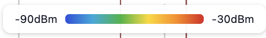
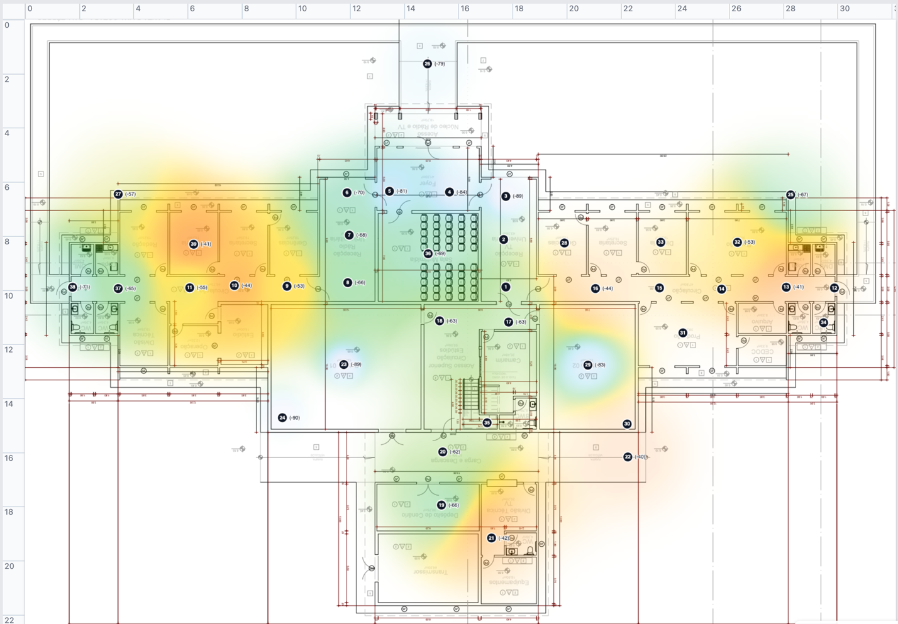
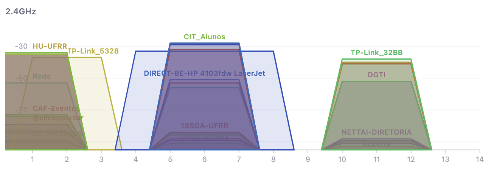
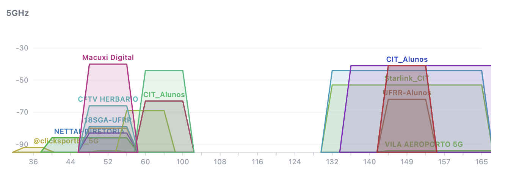

# Estudo de Caso — WiFi Viewer

> Termos técnicos usados aqui (SSID, BSSID, dBm, banda, heatmap etc.) estão explicados em [docs/00-glossary.md](00-glossary.md).

## 1. Sobre este documento

Este documento registra levantamentos reais feitos com o WiFi Viewer, usados para validar visualmente se o heatmap, a comparação de bandas e a legenda de cores (ver [docs/02-arch.md](02-arch.md), seção "Caminho de geração do heatmap") realmente ajudam a enxergar a cobertura Wi-Fi de um prédio real — não só em cenários sintéticos de teste.

As capturas de tela usadas aqui ficam em [`case-studies/images/`](case-studies/images/) como arquivos PNG próprios, não coladas em base64 dentro deste markdown — um arquivo `.md` com imagens em base64 embutidas facilmente passa de 1–2MB por captura, o que torna o histórico do Git pesado e desperdiça contexto toda vez que o documento é lido. Ver nota de metodologia na seção 3.

---

## 2. Estudo de Caso 1 — 1º piso do CIT: comparação 2.4GHz × 5GHz

### Objetivo

Verificar, num levantamento real de grande porte (39 pontos de medição, cobrindo praticamente todo o andar), como a cobertura Wi-Fi muda entre as duas bandas disponíveis no mesmo espaço físico — e se essa diferença aparece de forma clara no heatmap do app, sem precisar ler uma tabela de números.

### Leitura da legenda de cores

O heatmap usa uma escala térmica (ver ADR-020 em [docs/02-arch.md](02-arch.md)): quanto mais **vermelho**, mais forte o sinal (próximo de -30dBm); quanto mais **azul**, mais fraco (próximo de -90dBm). Áreas sem cor visível (planta "limpa" por baixo) indicam ausência de pontos medidos por perto, não sinal zero.

### Visão 2.4GHz (57 redes)

Sinais 2.4GHz predominantes na ala direita da planta:

- Ponto 14 — CIT_Alunos (-28 dBm)
- Ponto 15 — CIT_Servidores (-36 dBm)
- Ponto 31 — Starlink_CIT (-35 dBm)

Sinais 2.4GHz predominantes na ala esquerda:

- Ponto 10 — TP-Link_5328 (-37 dBm)
- Ponto 39 — TP-Link_32BB (-38 dBm)

Em 2.4GHz, a cobertura é visivelmente mais generosa: as manchas quentes (verde/amarelo/vermelho) se espalham por áreas maiores em torno de cada ponto, e praticamente todo o andar tem alguma cor visível — coerente com o alcance maior dessa banda.

### Visão 5GHz (24 redes)

Sinais 5GHz predominantes na ala direita:

- Ponto 13 — UFRR-Servidores (-41 dBm)

Sinais 5GHz predominantes na ala esquerda:

- Ponto 10 — TP-Link_5328_5G (-44 dBm)
- Ponto 39 — TP-Link_32BB_5G (-41 dBm)

Em 5GHz, menos da metade das redes vistas em 2.4GHz aparecem (24 contra 57) e as manchas de sinal forte ficam bem mais pontuais/concentradas em torno de cada ponto, com azul dominando boa parte do restante da planta — exatamente o comportamento esperado dessa banda (mais rápida, porém de alcance mais curto e mais atenuada por paredes).

### Comparação direta (mesmo ponto físico, banda diferente)

As leituras isoladas da seção anterior (só o ponto 10 e o 39) davam uma amostra pequena demais pra confirmar um padrão. Isolando cada AP dual-band individualmente no modo "rede única" (`Rede` = uma rede específica, `Banda` = Todas) foi possível comparar as duas bandas do **mesmo rádio físico** em muito mais pontos do levantamento — não só nos dois exemplos citados antes.

**TP-Link_5328 (2.4GHz) vs. TP-Link_5328_5G:**

| ![[tp-link_5328.png\|476]] | ![[tp-link_5328_5G.png\|402]] |
| ----------------------------------------- | ----------------------------------------- |

| Ponto | 2.4GHz  | 5GHz    | Queda  |
| ----- | ------- | ------- | ------ |
| 4     | -73 dBm | -84 dBm | -11 dB |
| 5     | -68 dBm | -81 dBm | -13 dB |
| 6     | -66 dBm | -70 dBm | -4 dB  |
| 7     | -56 dBm | -68 dBm | -12 dB |
| 8     | -57 dBm | -66 dBm | -9 dB  |
| 9     | -51 dBm | -53 dBm | -2 dB  |
| 10    | -37 dBm | -44 dBm | -7 dB  |
| 11    | -61 dBm | -66 dBm | -5 dB  |
| 24    | -78 dBm | -92 dBm | -14 dB |
| 26    | -74 dBm | -79 dBm | -5 dB  |
| 27    | -66 dBm | -69 dBm | -3 dB  |
| 36    | -73 dBm | -87 dBm | -14 dB |
| 37    | -59 dBm | -74 dBm | -15 dB |
| 38    | -66 dBm | -77 dBm | -11 dB |
| 39    | -47 dBm | -54 dBm | -7 dB  |

Queda média: **-8,8 dB** (15 pontos comparáveis; mínima -2 dB no ponto 9, máxima -15 dB no ponto 37).

**TP-Link_32BB (2.4GHz) vs. TP-Link_32BB_5G:**

| ![[tp-link_32BB.png\|569]] | ![[tp-link_32BB_5G.png\|531]] |
| -------------------------- | ----------------------------- |
|                            |                               |

| Ponto | 2.4GHz | 5GHz | Queda |
| ----- | ------ | ---- | ----- |
| 4 | -81 dBm | -90 dBm | -9 dB |
| 5 | -69 dBm | -83 dBm | -14 dB |
| 6 | -66 dBm | -84 dBm | -18 dB |
| 7 | -65 dBm | -77 dBm | -12 dB |
| 8 | -62 dBm | -76 dBm | -14 dB |
| 9 | -52 dBm | -68 dBm | -16 dB |
| 10 | -39 dBm | -47 dBm | -8 dB |
| 11 | -44 dBm | -55 dBm | -11 dB |
| 23 | -70 dBm | -89 dBm | -19 dB |
| 24 | -74 dBm | -90 dBm | -16 dB |
| 26 | -78 dBm | -84 dBm | -6 dB |
| 27 | -57 dBm | -57 dBm | 0 dB |
| 36 | -78 dBm | -88 dBm | -10 dB |
| 37 | -48 dBm | -65 dBm | -17 dB |
| 38 | -53 dBm | -71 dBm | -18 dB |
| 39 | -38 dBm | -41 dBm | -3 dB |

Queda média: **-11,9 dB** (16 pontos comparáveis; mínima 0 dB no ponto 27, máxima -19 dB no ponto 23).

Em 31 comparações ponto-a-ponto entre os dois APs, a banda 5GHz nunca chegou mais forte que a 2.4GHz no mesmo local — confirma com uma amostra grande, não só um ou dois pontos anedóticos. A queda não é uniforme: vai de 0 dB (ponto 27, TP-Link_32BB — os dois valores empatam, possível efeito de linha de visada direta ou de já estar perto do piso de ruído em ambas as bandas) a -19 dB (ponto 23) — sugerindo que obstáculos no caminho (paredes, pilares) penalizam a banda 5GHz de forma bem mais desigual pelo prédio do que uma queda fixa por distância explicaria sozinha.

### Distribuição de canais (visão de interferência)

Enquanto as seções anteriores comparam a *força* do sinal por banda, esta olha para *sobreposição de canal*. Cada trapézio é uma rede detectada em algum ponto do levantamento; o eixo horizontal é o canal Wi-Fi, o vertical é a força do sinal (dBm), e a largura do trapézio no eixo horizontal mostra quanto espectro (quantos canais) aquela rede efetivamente ocupa.

Em 2.4GHz, as redes se agrupam em três vizinhanças de canal, não distribuídas uniformemente pelos 14 canais disponíveis:

- **Canais ~1–3**: HU-UFRR, TP-Link_5328 e outras redes mais fracas empilhadas por baixo.
- **Canais ~4–8**: CIT_Alunos, DIRECT-8E-HP (uma impressora LaserJet) e 18SGA-UFRR quase totalmente sobrepostas — o exemplo mais claro de possível interferência co-canal deste levantamento.
- **Canais ~10–12**: TP-Link_32BB, DGTI, NETTAI-DIRETORIA e outras, também sobrepostas entre si.

Em 5GHz, o gráfico já deixa visível a divisão regulatória da banda em dois blocos de canais não contíguos (grosso modo, ~36–64 e ~132–165, com um vão vazio entre eles — não é ausência de dado, é faixa que o Wi-Fi 5GHz não usa nesses canais): 

- **Bloco baixo (~36–64)**: Macuxi Digital, CFTV HERBARIO, 18SGA-UFRR, NETTAI-DIRETORIA e @clicksportbr_5G concentradas numa faixa estreita de canais — bastante sobreposição para um bloco que, em teoria, tem mais canais livres disponíveis.
- **Bloco alto (~132–165)**: CIT_Alunos, Starlink_CIT, UFRR-Alunos e VILA AEROPORTO 5G convergindo perto do mesmo canal.

### Conclusões do Estudo de Caso 1

- A comparação lado a lado por banda (filtro já suportado pelo app, ver UC-005 no PRD) deixa evidente, sem precisar ler nenhum número, que a banda 5GHz cobre uma área bem menor que a 2.4GHz no mesmo prédio.
- A geometria em duas alas do prédio aparece claramente no heatmap: cada ala tende a ser dominada por um conjunto diferente de redes/pontos de acesso, o que é exatamente o tipo de padrão espacial que uma tabela de leituras isolada (sem a planta) não revela.
- A visão de canais (UC-006) mostra, num levantamento real, exatamente o cenário que ela foi desenhada para expor: redes vizinhas fisicamente competindo pelo mesmo canal, tanto em 2.4GHz quanto — de forma menos esperada — dentro dos blocos de 5GHz.
- Com 39 pontos reais espalhados por um andar inteiro, o heatmap manteve transições suaves e legendas coerentes com os dados brutos — validação de que o motor de interpolação (IDW, ver [docs/02-arch.md](02-arch.md)) generaliza bem além dos cenários sintéticos de poucos pontos usados durante o desenvolvimento (ADR-019 a ADR-031).

---

## 3. Nota de metodologia

Para manter este documento leve e fácil de revisar no Git:

- Screenshots do app devem ser salvos como arquivos PNG próprios em `docs/case-studies/images/`, com nome descritivo no padrão `<local>-<tipo-de-visão>-<banda-ou-filtro>.png` (ex.: `cit-piso1-heatmap-2-4ghz.png`, `cit-piso1-canais-5ghz.png`) — o `tipo-de-visão` (`heatmap`, `canais` etc.) evita ambiguidade entre capturas da mesma banda tiradas de telas diferentes do app. Referenciados no markdown via `` — nunca colados como `data:image/png;base64,...` nem como wikilink do tipo `![[arquivo.png]]` (sintaxe específica do Obsidian, não é markdown padrão e não renderiza fora dele) diretamente no texto.
- Números de sinal (dBm) e números de canal citados no texto devem vir de leitura direta no app (tooltip do ponto, painel de captura ou eixo do gráfico de canais) — não de leitura visual aproximada de uma captura de tela já reduzida/comprimida, que é sujeita a erro de transcrição; quando a leitura for aproximada por falta de acesso ao app, sinalizar isso explicitamente no texto (ex.: "~canal 6").
- Cada novo levantamento analisado entra como uma nova seção "Estudo de Caso N" neste documento, mantendo a mesma estrutura: objetivo, capturas com legenda, observações por banda/filtro, distribuição de canais quando houver, e conclusões.

---

## Ver também

- [docs/01-prd.md](01-prd.md) — casos de uso UC-005 (heatmap por rede) e UC-006 (comparação de canais) exercitados neste estudo.
- [docs/02-arch.md](02-arch.md) — como o heatmap e a comparação de bandas são calculados internamente.
- [docs/00-glossary.md](00-glossary.md) — termos técnicos usados aqui.
